<h1 align="center">KPB Algorithm</h1>
<h2 align="center">Strategi Optimasi Komputasi Awan (SOKA) 2026</h2>
<h3 align="center"><em>Optimasi Penjadwalan Task Menggunakan Algoritma KPB (K-Percent Best)</em></h3>
<h4 align="center">Departemen Teknologi Informasi Institut Teknologi Sepuluh Nopember (ITS)</h4>


---

## Anggota Kelompok 5

| No. | Nama Mahasiswa | NRP | Jobdesk |
| :---: | :--- | :---: | :--- |
| 1 | Naila Cahyarani Idelia | 5027241063 | - |
| 2 | Mey Roslaina | 5027241004 | - |
| 3 | Diva Aulia Rosa | 5027241003 | - |
| 4 | Fika Arka Nuriah | 5027241071 | Architecture Design & Algorithm Simulation |

---

## Daftar Isi

- [1. Pendahuluan](#1-pendahuluan)
- [2. Cara Kerja Algoritma KPB](#2-cara-kerja-algoritma-kpb)
- [3. Arsitektur Datacenter](#3-arsitektur-datacenter)
- [4. Implementasi di Kode](#4-implementasi-di-kode)
- [5. Dataset Uji Coba](#5-dataset-uji-coba)
- [6. Hasil Simulasi (CloudSim Plus)](#6-hasil-simulasi-cloudsim-plus)
- [7. Implementasi Real-World](#7-implementasi-real-world)
  - [7.1 Arsitektur](#71-arsitektur)
  - [7.2 Pemetaan Simulasi → Real World](#72-pemetaan-simulasi--real-world)
  - [7.3 Cara Menjalankan](#73-cara-menjalankan)
  - [7.4 Hasil Ujicoba Real-World](#74-hasil-ujicoba-real-world)
  - [7.5 Analisis Real-World](#75-analisis-real-world)
  - [7.6 Batasan Real-World](#76-batasan-real-world)
  - [7.7 Kesimpulan Real-World](#77-kesimpulan-real-world)
- [8. Panduan Menjalankan Sim](#8-panduan-menjalankan-sim)
- [9. Panduan Mengubah Datacenter, Host, dan VM](#9-panduan-mengubah-datacenter-host-dan-vm)
- [10. Struktur Direktori](#10-struktur-direktori)
- [11. Status dan Batasan](#11-status-dan-batasan)
- [12. Kesimpulan KPB](#12-kesimpulan-kpb)
- [13. Referensi](#13-referensi)
- [14. Hasil Perubahan](#14-hasil-perubahan)

---

## 1. Pendahuluan

### 1.1 Latar Belakang

Lingkungan cloud terdiri atas VM dengan kapasitas yang berbeda-beda, sedangkan ukuran task pada dataset GoCJ berkisar antara 15,000 hingga 900,000 MI. Penjadwal harus memutuskan VM mana yang mengerjakan setiap task. Ada dua pendekatan greedy klasik untuk keputusan ini, dan keduanya punya kelemahan:

- **MET (Minimum Execution Time)** selalu memilih VM yang paling cepat mengeksekusi task. Waktu antrean diabaikan, sehingga semua task menumpuk di VM tercepat.
- **MCT (Minimum Completion Time)** memilih VM yang paling cepat *menyelesaikan* task, yaitu waktu antre ditambah waktu eksekusi. Akibatnya task besar bisa dikirim ke VM lambat yang kebetulan sedang kosong.

### 1.2 Solusi: Algoritma KPB

**KPB (K-Percent Best)** adalah heuristik *immediate mode* yang diperkenalkan oleh Maheswaran dkk. (1999). KPB berada di antara MET dan MCT:

> *"Untuk setiap task, batasi pilihan hanya pada k% VM yang paling cocok untuk task itu, lalu di antara kandidat tersebut pilih VM yang paling cepat menyelesaikannya."*

Parameter **k** mengatur perilaku KPB:

```
k = 100/m %          →  hanya 1 kandidat     →  KPB = MET
k = 100 %            →  semua VM kandidat    →  KPB = MCT
100/m % < k < 100 %  →  kompromi: VM lambat tidak dipakai, antrean tetap diperhitungkan
```

Default yang dipakai di project ini adalah **k = 20%**, yaitu 4 dari 20 VM.

---

## 2. Cara Kerja Algoritma KPB

### 2.1 Notasi

| Simbol | Arti |
|:---|:---|
| `L_i` | Panjang task *i* (MI) |
| `C_j` | Kapasitas VM *j* (MIPS × PE) |
| `ETC(i,j) = L_i / C_j` | Waktu eksekusi task *i* di VM *j* |
| `ready_j` | Waktu VM *j* selesai mengerjakan antreannya |
| `CT(i,j) = ready_j + ETC(i,j)` | Waktu selesai task *i* bila ditaruh di VM *j* |
| `m` | Jumlah VM (20) |
| `s = ⌈k% × m⌉` | Ukuran subset kandidat (k = 20% → s = 4) |

### 2.2 Langkah Algoritma

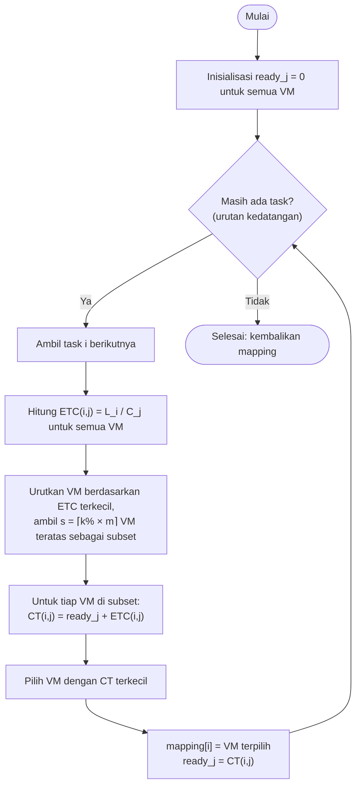

1. **Inisialisasi.** Waktu siap (`ready`) semua VM diset 0 karena semua task tiba bersamaan pada t = 0.
2. **Ambil task sesuai urutan kedatangan.** Task tidak diurutkan berdasarkan panjang.
3. **Bentuk subset k% terbaik.** Hitung waktu eksekusi task di setiap VM, urutkan, lalu ambil `s` VM dengan waktu eksekusi terkecil.
4. **Pilih completion time terkecil.** Di antara VM dalam subset, pilih VM dengan `ready + ETC` terkecil.
5. **Commit.** Catat assignment, lalu perbarui `ready` VM terpilih. Ulangi sampai semua task terjadwal.

### 2.3 Pseudocode

```text
KPB(tasks, vms, k):
    s ← max(1, ⌈k/100 × |vms|⌉)
    ready[j] ← 0 untuk setiap VM j
    for task i in tasks (urutan kedatangan):
        subset ← s VM dengan L_i / C_j terkecil
        best   ← argmin_{j ∈ subset} ( ready[j] + L_i / C_j )
        mapping[i] ← best
        ready[best] ← ready[best] + L_i / C_best
    return mapping
```

**Kompleksitas:** O(N · M log M) dengan N = jumlah task dan M = jumlah VM, karena VM diurutkan ulang untuk setiap task. Untuk N = 1,000 dan M = 20, prosesnya selesai dalam hitungan milidetik.

### 2.4 Contoh Perhitungan

Data contoh bawaan program memakai 5 task dan 20 VM dengan k = 20%, sehingga s = 4. Untuk setiap task, keempat VM V3 (10,000 MIPS) selalu menjadi kandidat terbaik.

| Task | Length (MI) | ETC di V3 | `ready` VM0..VM3 sebelum | CT kandidat | VM terpilih |
|:---:|---:|---:|:---:|:---:|:---:|
| 0 | 900,000 | 90 | 0, 0, 0, 0 | 90, 90, 90, 90 | VM0 |
| 1 | 600,000 | 60 | 90, 0, 0, 0 | 150, 60, 60, 60 | VM1 |
| 2 | 450,000 | 45 | 90, 60, 0, 0 | 135, 105, 45, 45 | VM2 |
| 3 | 300,000 | 30 | 90, 60, 45, 0 | 120, 90, 75, 30 | VM3 |
| 4 | 150,000 | 15 | 90, 60, 45, 30 | 105, 75, 60, **45** | VM3 |

Hasilnya `mapping = [0, 1, 2, 3, 3]`, sama dengan output `mvn -q exec:java`. Menurut rumus f1 desain, makespan-nya 90 s. Dengan Cloudlet memakai seluruh PE VM tujuan dan scheduler `SpaceShared`, makespan CloudSim menjadi **90.21 s**.

### 2.5 Perilaku KPB pada VM yang Konsisten

Pada konfigurasi project ini, VM yang lebih cepat selalu lebih cepat untuk **semua** task, karena `ETC = L / C`. Kondisi ini disebut *consistent ETC*. Akibatnya subset k% terbaik selalu berisi VM yang sama:

| k | Subset (s) | VM yang dipakai |
|:---:|:---:|:---|
| 20% | 4 | Hanya V3 (VM 0–3) |
| 50% | 10 | V3 + 6 VM V2 |
| 100% | 20 | Semua VM (setara MCT) |

Konsekuensinya, makin kecil k, makin sedikit VM yang terpakai, sehingga k menentukan seberapa terkonsolidasi beban kerja. Secara teori ini adalah tuas *trade-off* antara makespan dan energi. Namun hasil CloudSim (bagian 6.5, Gambar 6.3) menunjukkan bahwa pada desain ini konsolidasi justru **memperburuk** energi, karena keenam host tetap menyala dan makespan bertambah panjang.

---

## 3. Arsitektur Datacenter

> **Catatan:** bagian ini mendokumentasikan desain awal (2 datacenter × 3 host, 20 VM). Kode sekarang memakai topologi 3 datacenter × 2 host, 28 VM. Lihat [bagian 14. Hasil Perubahan](#14-hasil-perubahan).

Arsitektur terdiri atas dua datacenter dengan karakter berbeda: satu berorientasi kinerja dan satu berorientasi efisiensi energi.

Arsitektur ini dibangun di **CloudSim Plus 6.6.1** sesuai Draft Desain Project bagian 2. Penempatan VM pada gambar adalah hasil CloudSim yang sebenarnya (`results/simulation/placement.csv`). Tabel 3.1–3.5 merangkum isi gambar yang sama.

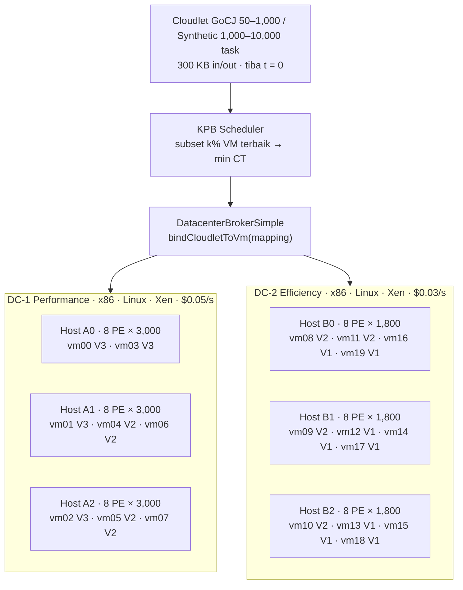

### 3.1 Spesifikasi Datacenter

| Atribut | DC-1 (Performance) | DC-2 (Efficiency) |
|:---|:---:|:---:|
| Jumlah host | 3 (Tipe A) | 3 (Tipe B) |
| Arsitektur / OS / VMM | x86 / Linux / Xen | x86 / Linux / Xen |
| VmAllocationPolicy | VmAllocationPolicySimple + batasan C3–C6 | VmAllocationPolicySimple + batasan C3–C6 |
| VmScheduler | VmSchedulerTimeShared | VmSchedulerTimeShared |
| CloudletScheduler VM | CloudletSchedulerSpaceShared | CloudletSchedulerSpaceShared |
| Cost per second | $0.05 | $0.03 |
| Cost per RAM (GB) | $0.02 | $0.01 |
| Cost per storage (GB) | $0.001 | $0.0008 |
| Cost per bandwidth (Mbps) | $0.005 | $0.003 |

### 3.2 Spesifikasi Host

| Tipe Host | Jumlah | PE × MIPS | RAM | Bandwidth | P idle | P maks |
|:---|:---:|:---:|:---:|:---:|:---:|:---:|
| A Performance (DC-1) | 3 | 8 × 3,000 | 32 GB | 10 Gbps | 175 W | 250 W |
| B Efficiency (DC-2) | 3 | 8 × 1,800 | 32 GB | 5 Gbps | 72 W | 120 W |
| **Total** | **6** | **48 PE · 115,200 MIPS** | **192 GB** | — | — | — |

Model daya: `PowerModelHostSimple`, linear `P(u) = P_idle + (P_maks − P_idle) × u`.

### 3.3 Spesifikasi VM

| Tipe VM | Jumlah | PE × MIPS | Kapasitas (C_j) | RAM | Bandwidth | Indeks | Ditempatkan di |
|:---|:---:|:---:|:---:|:---:|:---:|:---:|:---|
| V3 Large | 4 | 4 × 2,500 | 10,000 MIPS | 8 GB | 1 Gbps | VM 0–3 | DC-1 (hanya muat di Tipe A) |
| V2 Medium | 8 | 2 × 1,500 | 3,000 MIPS | 4 GB | 1 Gbps | VM 4–11 | 4 di DC-1, 4 di DC-2 |
| V1 Small | 8 | 1 × 1,000 | 1,000 MIPS | 2 GB | 500 Mbps | VM 12–19 | DC-2 |
| **Total** | **20** | **40 PE** | **72,000 MIPS** | **80 GB** | — | — | — |

### 3.4 Penempatan VM per Host

Hasil CloudSim (`VmAllocationPolicySimple` + batasan C3–C6), sama dengan gambar di atas dan dengan label `soka.host` container real-world:

| DC | Host | Tipe host | VM yang ditempatkan | PE terpakai | MIPS VM / MIPS host |
|:---:|:---:|:---:|:---|:---:|:---:|
| DC-1 Performance | A0 | A | vm00 V3, vm03 V3 | 8 / 8 | 20,000 / 24,000 |
| DC-1 Performance | A1 | A | vm01 V3, vm04 V2, vm06 V2 | 8 / 8 | 16,000 / 24,000 |
| DC-1 Performance | A2 | A | vm02 V3, vm05 V2, vm07 V2 | 8 / 8 | 16,000 / 24,000 |
| DC-2 Efficiency | B0 | B | vm08 V2, vm11 V2, vm16 V1, vm19 V1 | 6 / 8 | 8,000 / 14,400 |
| DC-2 Efficiency | B1 | B | vm09 V2, vm12 V1, vm14 V1, vm17 V1 | 5 / 8 | 6,000 / 14,400 |
| DC-2 Efficiency | B2 | B | vm10 V2, vm13 V1, vm15 V1, vm18 V1 | 5 / 8 | 6,000 / 14,400 |
| **Total** | **6** | — | **20 VM** | **40 / 48** | **72,000 / 115,200** |

### 3.5 Pembagian Host dan VM per Datacenter

Ringkasan tabel 3.4 per datacenter: host apa saja yang ada di tiap DC, VM apa saja yang berjalan di sana, dan berapa PE yang dipakai.

| Datacenter | Host | PE host | VM yang ditempatkan | Jumlah VM | PE VM terpakai / PE host | MIPS VM / MIPS host |
|:---|:---|:---:|:---|:---:|:---:|:---:|
| DC-1 Performance | A0, A1, A2 (3 × Tipe A) | 3 × 8 = 24 PE (@ 3,000 MIPS) | V3 Large: vm00–vm03 (4 PE/VM)<br/>V2 Medium: vm04–vm07 (2 PE/VM) | 8 (4 V3 + 4 V2) | 24 / 24 (100%) | 52,000 / 72,000 |
| DC-2 Efficiency | B0, B1, B2 (3 × Tipe B) | 3 × 8 = 24 PE (@ 1,800 MIPS) | V2 Medium: vm08–vm11 (2 PE/VM)<br/>V1 Small: vm12–vm19 (1 PE/VM) | 12 (4 V2 + 8 V1) | 16 / 24 (67%) | 20,000 / 43,200 |
| **Total** | **6 host** | **48 PE** | **V3 × 4, V2 × 8, V1 × 8** | **20** | **40 / 48** | **72,000 / 115,200** |

DC-1 terisi penuh (24/24 PE) karena keempat V3 hanya muat di host Tipe A (batasan C6), sehingga DC-1 menampung 72% kapasitas VM (52,000 dari 72,000 MIPS) dengan 8 VM. DC-2 menampung VM yang lebih kecil tetapi lebih banyak (12 VM) dan masih menyisakan 8 PE.

### 3.6 Batasan Keras (Desain bagian 4.3)

| Kode | Batasan | Cara dipenuhi di kode |
|:---:|:---|:---|
| C1 | Setiap task tepat di satu VM | `mapping[i]` berisi satu indeks VM; `SimulationSetup` mengecek tiap cloudlet berjalan di VM hasil KPB |
| C2 | Setiap VM tepat di satu host | Ditangani CloudSim; `SimulationSetup` memvalidasi 20/20 VM berhasil dibuat |
| C3 | Σ PE VM ≤ PE host | `ConstrainedPlacement`. `VmSchedulerTimeShared` bawaan hanya mengecek MIPS dan sempat menaruh 11 PE di host 8 PE |
| C4, C5 | RAM dan bandwidth host tidak terlampaui | `ConstrainedPlacement` + `Host.isSuitableForVm()` |
| C6 | MIPS per PE VM ≤ MIPS per PE host | `ConstrainedPlacement`: V3 (2,500) ditolak oleh host Tipe B (1,800) |
| C7 | Non-preemptive | Cloudlet tidak pernah dihentikan atau dipindah VM (tidak ada migrasi) |
| C8 | Variabel keputusan biner | Satu task → satu VM, satu VM → satu host |

---

## 4. Implementasi di Kode

### 4.1 Alur Program

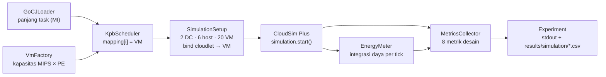

KPB hanya melihat panjang task dan kapasitas VM (rumus f1 desain) untuk mengambil keputusan. Di CloudSim, setiap Cloudlet memakai semua PE VM tujuan dan scheduler `SpaceShared` mengantrekannya per VM. RAM/BW, daya, dan biaya tetap dimodelkan oleh CloudSim.

### 4.2 Daftar File

| File | Peran |
|:---|:---|
| [`KpbScheduler.java`](src/main/java/project/scheduler/KpbScheduler.java) | Algoritma KPB |
| [`Scheduler.java`](src/main/java/project/scheduler/Scheduler.java) | Antarmuka seragam: `int[] schedule(taskLength, vmCapacity)` |
| [`Experiment.java`](src/main/java/project/Experiment.java) | Entry point: dataset → KPB → CloudSim → metrik → CSV |
| [`GoCJLoader.java`](src/main/java/project/data/GoCJLoader.java) | Membaca file GoCJ (satu nilai MI per baris) |
| [`DatacenterFactory.java`](src/main/java/project/setup/DatacenterFactory.java) | 2 DC, 6 host, model daya, biaya, scheduling interval 1 s |
| [`VmFactory.java`](src/main/java/project/setup/VmFactory.java) | 20 VM (V3/V2/V1) dengan `CloudletSchedulerSpaceShared` |
| [`ConstrainedPlacement.java`](src/main/java/project/setup/ConstrainedPlacement.java) | Pemilihan host yang menegakkan C3–C6, dan rencana VM → DC |
| [`SimulationSetup.java`](src/main/java/project/setup/SimulationSetup.java) | Broker, cloudlet (300 KB, UtilizationModel), binding, validasi |
| [`CloudSimAdapter.java`](src/main/java/project/setup/CloudSimAdapter.java) | Mengubah VM CloudSim menjadi array kapasitas untuk scheduler |
| [`EnergyMeter.java`](src/main/java/project/metrics/EnergyMeter.java) | Integrasi `P(u)` semua host dari 0 sampai makespan |
| [`MetricsCollector.java`](src/main/java/project/metrics/MetricsCollector.java) | Menghitung 8 metrik desain dari hasil CloudSim |
| [`ScheduleEvaluator.java`](src/main/java/project/model/ScheduleEvaluator.java), [`ScheduleContext.java`](src/main/java/project/model/ScheduleContext.java) | Model analitik f1 (makespan) dan energi, untuk baris `prediksi analitik` di setiap run |

### 4.3 Pemetaan Langkah KPB ke Kode

| Langkah | Kode di `KpbScheduler.schedule()` |
|:---|:---|
| 1. Task diproses sesuai urutan kedatangan | `for (int task = 0; task < taskLength.length; task++)` |
| 2. Ranking VM berdasarkan ETC | `rankByExecutionTime(taskLength[task], vmCapacity)` |
| 3. Ambil subset k% | `for (int c = 0; c < subsetSize; c++)` dengan `subsetSize = ⌈k% × m⌉` |
| 4. Pilih min completion time | `finish = readyTime[vm] + taskLength[task] / vmCapacity[vm]` |
| 5. Commit dan update ready time | `mapping[task] = selectedVm; readyTime[selectedVm] = bestFinish;` |

### 4.4 Catatan Implementasi CloudSim

Tiga jebakan CloudSim Plus 6.6.1 yang ditemukan dan ditangani. Ketiganya membuat hasil salah **tanpa pesan error**:

1. **`bindCloudletToVm` diam-diam gagal** bila dipanggil sebelum `submitCloudletList` (mengembalikan `false`). Broker lalu membagi task secara round-robin, sehingga hasil "KPB" sebenarnya hasil round-robin. Binding kini dilakukan setelah submit, dan setiap hasilnya dicek.
2. **VmSchedulerTimeShared tidak membatasi jumlah PE**, hanya MIPS. Tanpa `ConstrainedPlacement`, ke-20 VM dimasukkan ke DC-1 (host berisi 11 PE dari 8) dan DC-2 kosong, sehingga melanggar C3.
3. **VM yang di-retry ke DC-2 tidak pernah menerima cloudlet**: 43 dari 100 cloudlet tertinggal berstatus QUEUED. Penempatan VM → DC kini direncanakan di awal dengan aturan yang sama, sehingga tidak ada retry.

Setiap run memvalidasi: 20/20 VM dibuat, setiap cloudlet berjalan di VM hasil KPB, dan semua cloudlet selesai.

---

## 5. Dataset Uji Coba

| Aspek | GoCJ | Synthetic |
|:---|:---|:---|
| Sumber | GoCJ (Google Cloud Jobs) Dataset, Mendeley Data, diturunkan dari jejak beban kerja Google cluster | Dibuat dari GoCJ dengan [`realworld/generate_synthetic.py`](realworld/generate_synthetic.py) |
| Ukuran | 50, 100, 200, 300, 400, 500, 600, 700, 800, 900, 1,000 task | 1,000, 2,000, 3,000, …, 10,000 task |
| File | `GoCJ_Dataset_<N>.txt`; ukuran 50 = `GoCJ_Dataset_50_subset.txt` (50 baris pertama GoCJ 100, karena tidak ada file resmi GoCJ 50) | `Synthetic_Dataset_<N>.txt` |
| Format | Teks, satu panjang task (MI) per baris | Sama |
| Rentang | 15,000 – 900,000 MI | 15,000 – 900,000 MI |

**Cara membuat dataset synthetic.** Semua file GoCJ resmi (100–1,000, total 5,500 task) digabung menjadi satu pool, lalu setiap ukuran N diambil acak *dengan pengembalian* (bootstrap) dari pool itu. Setiap ukuran memakai generatornya sendiri, `random.Random(42 + N)`, sehingga file yang sama selalu terbentuk ulang identik. Distribusinya mengikuti GoCJ: kuartil sama, rata-rata berbeda ≤ 2.9%, jarak Kolmogorov-Smirnov ≤ 0.024.

```bash
python3 realworld/generate_synthetic.py --dir src/main/resources/dataset --seed 42
```

Rata-rata panjang task tiap file GoCJ tidak sama persis (124,991–138,420 MI), sehingga total beban (Σ MI) tidak naik linear terhadap jumlah task. Contohnya GoCJ 600 berisi 82.3 juta MI (naik 27% dari GoCJ 500), sedangkan GoCJ 700 hanya 87.5 juta MI (naik 6%). Hal ini menjelaskan "tangga" pada grafik makespan GoCJ (Gambar 6.1).

Pemetaan ke cloudlet (Desain bagian 1.3):

| Parameter cloudlet | Nilai |
|:---|:---|
| `length` | Panjang per PE: panjang MI dataset dibagi jumlah PE VM tujuan |
| `numberOfPes` | Sama dengan PE VM tujuan (V3=4, V2=2, V1=1) |
| `fileSize` / `outputSize` | 300 KB / 300 KB |
| `utilizationModelCpu` | `UtilizationModelFull` (100%) |
| `utilizationModelRam` / `Bw` | `UtilizationModelDynamic` 20% |
| Waktu kedatangan | Serentak pada t = 0 (offline batch) |

---

## 6. Hasil Simulasi (CloudSim Plus)

Semua angka di bagian ini adalah hasil **simulasi CloudSim Plus 6.6.1 penuh**, bukan hitungan rumus. Rumus (model analitik f1 dan rumus kapasitas di 6.6) hanya dipakai sebagai pembanding dan penjelasan.

### 6.1 Cara Pengujian di CloudSim Plus

Setiap run (satu dataset, satu nilai k) menjalankan [`project.Experiment`](src/main/java/project/Experiment.java):

1. **Penjadwalan.** `GoCJLoader` membaca dataset, lalu `KpbScheduler` menghasilkan mapping task → VM hanya dari panjang task (MI) dan kapasitas VM (MIPS × PE).
2. **Membangun infrastruktur di CloudSim.** `SimulationSetup` membuat infrastruktur bagian 3 sebagai objek CloudSim: 2 `Datacenter`, 6 `Host` dengan `PowerModelHostSimple`, dan 20 `Vm` dengan `CloudletSchedulerSpaceShared`. Penempatan VM mengikuti batasan C3–C6. Setiap task menjadi satu `Cloudlet` (300 KB in/out, tiba di t = 0).
3. **Binding.** Setiap cloudlet diikat ke VM pilihan KPB lewat `DatacenterBrokerSimple.bindCloudletToVm`, dan hasil binding dicek.
4. **Simulasi.** `simulation.start()` menjalankan simulasi *event-driven*: cloudlet diantre per VM, dieksekusi memakai seluruh PE VM, lalu selesai pada waktu simulasi.
5. **Validasi.** Program berhenti tanpa mencetak metrik bila VM yang dibuat kurang dari 20/20, ada cloudlet yang berjalan di VM lain selain pilihan KPB, atau ada cloudlet yang tidak selesai.
6. **Metrik.** `MetricsCollector` dan `EnergyMeter` menghitung 8 metrik dari objek CloudSim: waktu mulai dan selesai cloudlet, utilisasi host per tick (energi), dan `VmCost` (biaya).

Bukti dari log run Synthetic 10,000 task dengan k = 20% (dipotong):

```text
=== Infrastruktur CloudSim ===
DC-1 Performance | x86 / Linux / Xen | 3 host | $0.05/s, $0.02/GB RAM, $0.0010/GB storage, $0.005/Mbps BW
  Host 0 | 8 PE x 3000 MIPS | RAM 32 GB | BW 10000 Mbps | P idle 175 W, P max 250 W | PE terpakai 8/8
    vm0  V3 | 4 PE x 2500 MIPS | RAM 8 GB | BW 1000 Mbps
    ...
Total: 2 datacenter, 6 host, 20 VM

scheduler=KPB(k=20.0%)
tasks=10000, vmsCreated=20/20, cloudletsFinished=10000/10000
makespan=32947.100 s (analitik 32447.350 s), energy=7.9140 kWh, avgResponse=16341.771 s
utilization=19.96%, DI=5.0088 (VM terpakai 0.0027), throughput=0.3035 task/s
cost=$39601.93, schedulingTime=6.671 ms
vmFinish=[32947.1, 32874.03, 32875.61, 32859.1, 0.0, 0.0, 0.0, 0.0, 0.0, 0.0, 0.0, 0.0, 0.0, 0.0, 0.0, 0.0, 0.0, 0.0, 0.0, 0.0]
```

| Grid | Ukuran dataset | k | Run | Folder sesi |
|:---|:---|:---:|:---:|:---|
| GoCJ | 50, 100, 200, …, 1,000 (11 ukuran) | 20, 50, 100% | 33 | [`results/sessions/cloudsim_gocj_20261009_225810/`](results/sessions/cloudsim_gocj_20261009_225810/) |
| Synthetic | 1,000, 2,000, …, 10,000 (10 ukuran) | 20, 50, 100% | 30 | [`results/sessions/cloudsim_synthetic_20261009_225854/`](results/sessions/cloudsim_synthetic_20261009_225854/) |

CloudSim deterministik, jadi cukup satu run per sel. Grid synthetic dijalankan ulang pada 2026-10-11 dengan kode terbaru (setelah HS/CSA dihapus). Hasilnya identik di 30/30 sel untuk tujuh metrik; hanya waktu penjadwalan yang sedikit berbeda karena diukur dengan jam dinding (contoh: 10,000 task, k = 100%: 5.76 ms vs 5.22 ms).

```bash
SOURCE=gocj bash scripts/run_grid_cloudsim.sh         # GoCJ, ±1 menit
SOURCE=synthetic bash scripts/run_grid_cloudsim.sh    # Synthetic, ±3 menit
```

Keterangan kolom tabel 6.2–6.3: energi mencakup 6 host dari t = 0 sampai makespan, termasuk daya idle; biaya = CPU + RAM + bandwidth (`VmCost`); DI = (T_maks − T_min) / T_rata-rata atas waktu selesai 20 VM. **Tebal** menandai nilai terbaik di antara ketiga k untuk jumlah task yang sama. Waktu penjadwalan diukur dengan jam dinding dan dipengaruhi JIT/GC, sehingga tidak diberi tanda tebal.

### 6.2 Hasil GoCJ 50–1,000 Task

| Task | k | Makespan (s) | Energi (kWh) | Biaya (USD) | Avg response time (s) | Utilisasi (%) | Degree of Imbalance (20 VM) | Throughput (task/s) | Waktu penjadwalan (ms) |
|---:|:---:|---:|---:|---:|---:|---:|---:|---:|---:|
| 50 | 20% | 213.00 | 0.0499 | 321.01 | 74.35 | 16.45 | 6.079 | 0.235 | 0.36 |
| 50 | 50% | 174.75 | 0.0420 | 275.12 | 53.26 | 30.27 | 3.304 | 0.286 | 0.13 |
| 50 | 100% | **168.85** | **0.0408** | **268.03** | **47.82** | **37.50** | **2.667** | **0.296** | 0.34 |
| 100 | 20% | 367.80 | 0.0875 | 506.77 | 164.19 | 18.64 | 5.364 | 0.272 | 0.44 |
| 100 | 50% | 273.35 | 0.0681 | 393.43 | 111.88 | 41.06 | 2.436 | 0.366 | 0.53 |
| 100 | 100% | **233.08** | **0.0599** | **345.11** | **90.71** | **70.45** | **0.747** | **0.429** | 0.36 |
| 200 | 20% | 713.82 | 0.1707 | 922.00 | 372.66 | 19.35 | 5.169 | 0.280 | 1.17 |
| 200 | 50% | 521.16 | 0.1312 | 690.80 | 254.24 | 44.38 | 2.253 | 0.384 | 0.61 |
| 200 | 100% | **436.75** | **0.1140** | **589.51** | **201.84** | **82.49** | **0.335** | **0.458** | 0.89 |
| 300 | 20% | 1,091.55 | 0.2610 | 1,375.27 | 545.77 | 19.30 | 5.182 | 0.275 | 0.76 |
| 300 | 50% | 781.42 | 0.1973 | 1,003.12 | 371.85 | 45.54 | 2.196 | 0.384 | 0.69 |
| 300 | 100% | **648.65** | **0.1703** | **843.79** | **293.23** | **86.34** | **0.259** | **0.462** | 0.44 |
| 400 | 20% | 1,321.78 | 0.3174 | 1,651.55 | 644.62 | 19.93 | 5.019 | 0.303 | 0.45 |
| 400 | 50% | 911.93 | 0.2332 | 1,159.73 | 441.69 | 49.32 | 2.028 | 0.439 | 0.60 |
| 400 | 100% | **757.30** | **0.2019** | **974.17** | **354.80** | **93.12** | **0.182** | **0.528** | 5.83 |
| 500 | 20% | 1,655.38 | 0.3976 | 2,051.87 | 826.73 | 19.94 | 5.016 | 0.302 | 0.49 |
| 500 | 50% | 1,146.19 | 0.2930 | 1,440.84 | 565.91 | 48.99 | 2.041 | 0.436 | 0.56 |
| 500 | 100% | **933.07** | **0.2497** | **1,185.10** | **452.88** | **95.29** | **0.112** | **0.536** | 0.90 |
| 600 | 20% | 2,122.40 | 0.5088 | 2,612.29 | 1,021.66 | 19.68 | 5.081 | 0.283 | 0.85 |
| 600 | 50% | 1,486.67 | 0.3783 | 1,849.42 | 698.54 | 47.71 | 2.096 | 0.404 | 1.29 |
| 600 | 100% | **1,215.70** | **0.3232** | **1,524.26** | **558.96** | **92.33** | **0.131** | **0.494** | 2.11 |
| 700 | 20% | 2,242.36 | 0.5381 | 2,756.24 | 1,159.95 | 19.83 | 5.044 | 0.312 | 0.73 |
| 700 | 50% | 1,549.90 | 0.3958 | 1,925.29 | 794.79 | 48.85 | 2.047 | 0.452 | 1.86 |
| 700 | 100% | **1,265.28** | **0.3380** | **1,583.74** | **637.46** | **95.33** | **0.092** | **0.553** | 1.28 |
| 800 | 20% | 2,540.16 | 0.6094 | 3,113.60 | 1,312.54 | 19.80 | 5.051 | 0.315 | 1.10 |
| 800 | 50% | 1,769.17 | 0.4510 | 2,188.41 | 898.54 | 48.47 | 2.063 | 0.452 | 1.71 |
| 800 | 100% | **1,440.14** | **0.3842** | **1,793.59** | **721.09** | **94.32** | **0.107** | **0.555** | 1.71 |
| 900 | 20% | 3,065.60 | 0.7359 | 3,744.13 | 1,461.48 | 19.88 | 5.031 | 0.294 | 0.86 |
| 900 | 50% | 2,127.51 | 0.5433 | 2,618.43 | 1,000.69 | 48.70 | 2.053 | 0.423 | 2.19 |
| 900 | 100% | **1,725.95** | **0.4617** | **2,136.55** | **802.66** | **95.22** | **0.088** | **0.521** | 1.77 |
| 1,000 | 20% | 3,331.27 | 0.7990 | 4,062.94 | 1,602.00 | 19.76 | 5.060 | 0.300 | 2.61 |
| 1,000 | 50% | 2,313.56 | 0.5900 | 2,841.69 | 1,097.82 | 48.48 | 2.063 | 0.432 | 10.08 |
| 1,000 | 100% | **1,880.16** | **0.5020** | **2,321.60** | **881.11** | **94.40** | **0.099** | **0.532** | 6.15 |

### 6.3 Hasil Synthetic 1,000–10,000 Task

| Task | k | Makespan (s) | Energi (kWh) | Biaya (USD) | Avg response time (s) | Utilisasi (%) | Degree of Imbalance (20 VM) | Throughput (task/s) | Waktu penjadwalan (ms) |
|---:|:---:|---:|---:|---:|---:|---:|---:|---:|---:|
| 1,000 | 20% | 3,368.71 | 0.8093 | 4,107.86 | 1,660.13 | 19.98 | 5.005 | 0.297 | 4.53 |
| 1,000 | 50% | 2,342.94 | 0.5986 | 2,876.94 | 1,136.67 | 48.99 | 2.041 | 0.427 | 1.51 |
| 1,000 | 100% | **1,898.59** | **0.5084** | **2,343.72** | **910.90** | **96.26** | **0.068** | **0.527** | 2.78 |
| 2,000 | 20% | 6,555.52 | 1.5745 | 7,932.04 | 3,241.47 | 19.95 | 5.012 | 0.305 | 10.27 |
| 2,000 | 50% | 4,509.15 | 1.1543 | 5,476.39 | 2,220.92 | 49.60 | 2.016 | 0.444 | 3.05 |
| 2,000 | 100% | **3,641.61** | **0.9780** | **4,435.34** | **1,782.68** | **98.16** | **0.036** | **0.549** | 3.69 |
| 3,000 | 20% | 9,889.06 | 2.3757 | 11,932.28 | 5,028.41 | 19.99 | 5.004 | 0.303 | 3.01 |
| 3,000 | 50% | 6,813.39 | 1.7441 | 8,241.48 | 3,445.38 | 49.64 | 2.015 | 0.440 | 4.81 |
| 3,000 | 100% | **5,498.37** | **1.4770** | **6,663.45** | **2,765.82** | **98.50** | **0.025** | **0.546** | 2.12 |
| 4,000 | 20% | 13,569.76 | 3.2597 | 16,349.12 | 6,721.99 | 19.97 | 5.008 | 0.295 | 4.83 |
| 4,000 | 50% | 9,318.29 | 2.3866 | 11,247.36 | 4,605.74 | 49.79 | 2.009 | 0.429 | 4.52 |
| 4,000 | 100% | **7,508.90** | **2.0190** | **9,076.09** | **3,697.24** | **98.91** | **0.021** | **0.533** | 2.59 |
| 5,000 | 20% | 16,102.78 | 3.8683 | 19,388.75 | 8,075.77 | 19.98 | 5.005 | 0.311 | 8.72 |
| 5,000 | 50% | 11,067.06 | 2.8341 | 13,345.88 | 5,533.14 | 49.75 | 2.010 | 0.452 | 3.46 |
| 5,000 | 100% | **8,921.40** | **2.3981** | **10,771.09** | **4,442.93** | **98.94** | **0.018** | **0.560** | 4.52 |
| 6,000 | 20% | 20,023.90 | 4.8096 | 24,094.09 | 9,866.83 | 19.96 | 5.011 | 0.300 | 12.06 |
| 6,000 | 50% | 13,757.33 | 3.5227 | 16,574.21 | 6,761.20 | 49.71 | 2.011 | 0.436 | 2.46 |
| 6,000 | 100% | **11,075.99** | **2.9778** | **13,356.60** | **5,428.41** | **99.02** | **0.016** | **0.542** | 3.98 |
| 7,000 | 20% | 23,317.97 | 5.6011 | 28,046.98 | 11,663.32 | 19.96 | 5.009 | 0.300 | 5.07 |
| 7,000 | 50% | 16,024.55 | 4.1032 | 19,294.87 | 7,992.54 | 49.73 | 2.011 | 0.437 | 3.64 |
| 7,000 | 100% | **12,906.13** | **3.4696** | **15,552.77** | **6,418.09** | **98.99** | **0.016** | **0.542** | 22.79 |
| 8,000 | 20% | 26,319.90 | 6.3231 | 31,649.29 | 13,218.22 | 19.99 | 5.003 | 0.304 | 5.74 |
| 8,000 | 50% | 18,082.98 | 4.6315 | 21,764.99 | 9,058.51 | 49.81 | 2.008 | 0.442 | 3.13 |
| 8,000 | 100% | **14,541.63** | **3.9119** | **17,515.37** | **7,274.23** | **99.37** | **0.012** | **0.550** | 5.63 |
| 9,000 | 20% | 29,835.18 | 7.1681 | 35,867.63 | 14,996.62 | 19.99 | 5.001 | 0.302 | 4.62 |
| 9,000 | 50% | 20,484.53 | 5.2478 | 24,646.85 | 10,277.69 | 49.87 | 2.005 | 0.439 | 1.77 |
| 9,000 | 100% | **16,479.34** | **4.4340** | **19,840.62** | **8,253.47** | **99.44** | **0.012** | **0.546** | 5.07 |
| 10,000 | 20% | 32,947.10 | 7.9140 | 39,601.93 | 16,341.77 | 19.96 | 5.009 | 0.304 | 5.43 |
| 10,000 | 50% | 22,637.46 | 5.7967 | 27,230.37 | 11,197.56 | 49.76 | 2.010 | 0.442 | 4.24 |
| 10,000 | 100% | **18,233.23** | **4.9018** | **21,945.29** | **8,991.59** | **99.10** | **0.014** | **0.548** | 5.76 |

### 6.4 Tabel Perbedaan antar k

Selisih = nilai k yang lebih besar dikurangi nilai k yang lebih kecil; persen relatif terhadap k yang lebih kecil (negatif = turun). Kolom terakhir adalah makespan CloudSim dibagi makespan rumus f1 desain (antrean sekuensial per VM, `max_j Σ L_i / C_j`).

**GoCJ**

| Task | Makespan k = 20% → 50% (s) | Makespan k = 50% → 100% (s) | Makespan k = 20% → 100% (s) | Energi k = 20% → 100% | Biaya k = 20% → 100% | Throughput k = 20% → 100% | CloudSim / analitik f1 (k = 20 / 50 / 100%) |
|---:|---:|---:|---:|---:|---:|---:|:---:|
| 50 | -38.25 (-18.0%) | -5.90 (-3.4%) | -44.15 (-20.7%) | -18.1% | -16.5% | 26.0% | 1.006 / 1.004 / 1.010 |
| 100 | -94.45 (-25.7%) | -40.27 (-14.7%) | -134.72 (-36.6%) | -31.5% | -31.9% | 57.7% | 1.015 / 1.009 / 1.009 |
| 200 | -192.66 (-27.0%) | -84.41 (-16.2%) | -277.07 (-38.8%) | -33.2% | -36.1% | 63.6% | 1.013 / 1.008 / 1.007 |
| 300 | -310.13 (-28.4%) | -132.77 (-17.0%) | -442.90 (-40.6%) | -34.7% | -38.6% | 68.0% | 1.013 / 1.009 / 1.006 |
| 400 | -409.85 (-31.0%) | -154.63 (-17.0%) | -564.48 (-42.7%) | -36.4% | -41.0% | 74.3% | 1.018 / 1.011 / 1.008 |
| 500 | -509.19 (-30.8%) | -213.12 (-18.6%) | -722.31 (-43.6%) | -37.2% | -42.2% | 77.5% | 1.015 / 1.010 / 1.008 |
| 600 | -635.73 (-30.0%) | -270.97 (-18.2%) | -906.70 (-42.7%) | -36.5% | -41.7% | 74.6% | 1.013 / 1.009 / 1.006 |
| 700 | -692.46 (-30.9%) | -284.62 (-18.4%) | -977.08 (-43.6%) | -37.2% | -42.5% | 77.2% | 1.016 / 1.011 / 1.007 |
| 800 | -770.99 (-30.4%) | -329.02 (-18.6%) | -1,100.02 (-43.3%) | -37.0% | -42.4% | 76.2% | 1.015 / 1.012 / 1.009 |
| 900 | -938.09 (-30.6%) | -401.57 (-18.9%) | -1,339.65 (-43.7%) | -37.3% | -42.9% | 77.2% | 1.015 / 1.010 / 1.007 |
| 1,000 | -1,017.71 (-30.6%) | -433.40 (-18.7%) | -1,451.11 (-43.6%) | -37.2% | -42.9% | 77.3% | 1.016 / 1.011 / 1.007 |

**Synthetic**

| Task | Makespan k = 20% → 50% (s) | Makespan k = 50% → 100% (s) | Makespan k = 20% → 100% (s) | Energi k = 20% → 100% | Biaya k = 20% → 100% | Throughput k = 20% → 100% | CloudSim / analitik f1 (k = 20 / 50 / 100%) |
|---:|---:|---:|---:|---:|---:|---:|:---:|
| 1,000 | -1,025.77 (-30.4%) | -444.35 (-19.0%) | -1,470.12 (-43.6%) | -37.2% | -42.9% | 77.4% | 1.015 / 1.010 / 1.008 |
| 2,000 | -2,046.37 (-31.2%) | -867.54 (-19.2%) | -2,913.91 (-44.4%) | -37.9% | -44.1% | 80.0% | 1.015 / 1.011 / 1.007 |
| 3,000 | -3,075.67 (-31.1%) | -1,315.02 (-19.3%) | -4,390.69 (-44.4%) | -37.8% | -44.2% | 80.2% | 1.016 / 1.010 / 1.007 |
| 4,000 | -4,251.47 (-31.3%) | -1,809.39 (-19.4%) | -6,060.86 (-44.7%) | -38.1% | -44.5% | 80.7% | 1.015 / 1.009 / 1.007 |
| 5,000 | -5,035.72 (-31.3%) | -2,145.66 (-19.4%) | -7,181.38 (-44.6%) | -38.0% | -44.4% | 80.1% | 1.016 / 1.010 / 1.009 |
| 6,000 | -6,266.57 (-31.3%) | -2,681.34 (-19.5%) | -8,947.91 (-44.7%) | -38.1% | -44.6% | 80.7% | 1.015 / 1.010 / 1.008 |
| 7,000 | -7,293.42 (-31.3%) | -3,118.42 (-19.5%) | -10,411.84 (-44.7%) | -38.1% | -44.5% | 80.7% | 1.015 / 1.010 / 1.008 |
| 8,000 | -8,236.92 (-31.3%) | -3,541.35 (-19.6%) | -11,778.27 (-44.8%) | -38.1% | -44.7% | 80.9% | 1.015 / 1.011 / 1.008 |
| 9,000 | -9,350.65 (-31.3%) | -4,005.19 (-19.6%) | -13,355.84 (-44.8%) | -38.1% | -44.7% | 80.8% | 1.015 / 1.010 / 1.008 |
| 10,000 | -10,309.64 (-31.3%) | -4,404.23 (-19.5%) | -14,713.87 (-44.7%) | -38.1% | -44.6% | 80.3% | 1.015 / 1.010 / 1.009 |

### 6.5 Grafik Perbandingan (Line Chart)

Semua grafik memakai format yang sama: sumbu x = **jumlah task**, sumbu y = **metrik yang diukur** (dengan satuannya), panel kiri = dataset **GoCJ** (50–1,000 task), panel kanan = dataset **Synthetic** (1,000–10,000 task), dan satu garis untuk setiap nilai **k** (biru = 20%, oranye = 50%, hijau = 100%).

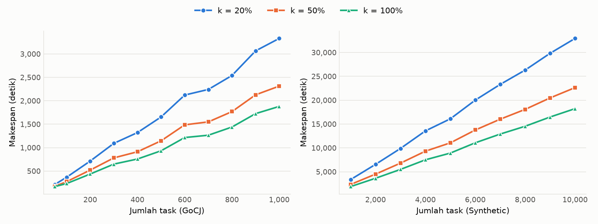

**Gambar 6.1 Makespan.** Grafik ini menunjukkan waktu sampai task terakhir selesai (makespan) untuk setiap jumlah task.
*Analisis:* Makespan naik lurus seiring jumlah task karena total beban bertambah. k = 100% selalu paling rendah karena memakai seluruh 20 VM (72,000 MIPS), sedangkan k = 20% hanya memakai 4 VM V3 (40,000 MIPS). Garis GoCJ berbentuk "tangga" karena total panjang task tiap file GoCJ tidak sebanding dengan jumlah task-nya (GoCJ 600 naik 27% dari GoCJ 500, GoCJ 700 hanya naik 6%).

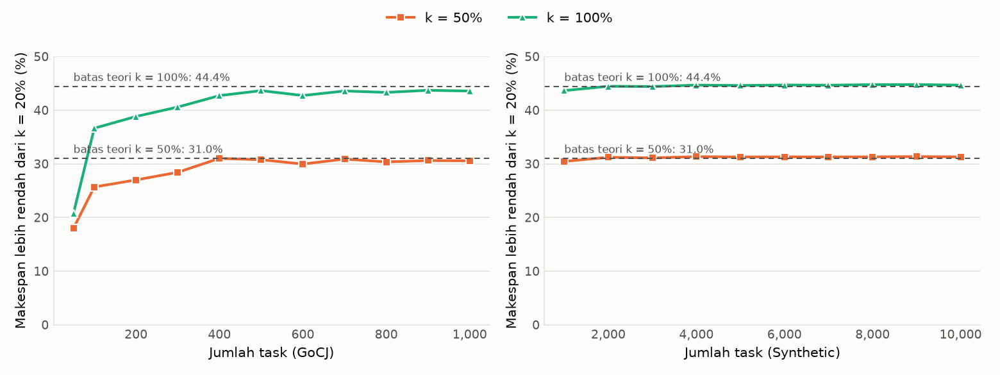

**Gambar 6.2 Selisih makespan terhadap k = 20%.** Grafik ini menunjukkan berapa persen makespan k = 50% dan k = 100% lebih rendah daripada k = 20%. Garis putus-putus adalah batas teori.
*Analisis:* Selisihnya naik lalu mendatar di ±31% (k = 50%) dan ±44% (k = 100%), sama dengan batas teori 1 − 40,000/58,000 dan 1 − 40,000/72,000 (perbandingan kapasitas VM yang dipakai). Pada task sedikit (GoCJ di bawah 400 task) selisihnya lebih kecil karena makespan ditentukan oleh beberapa task raksasa (hingga 900,000 MI) yang tidak bisa dibagi ke VM lain.

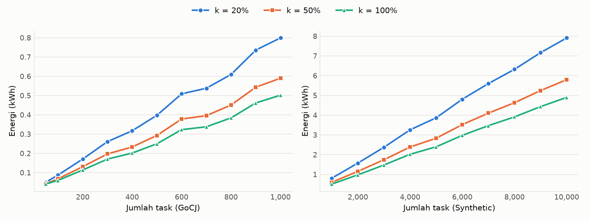

**Gambar 6.3 Energi.** Grafik ini menunjukkan total energi keenam host selama simulasi (kWh).
*Analisis:* Energi mengikuti makespan karena keenam host menyala terus selama simulasi (daya idle total 741 W). Penurunannya lebih kecil dari makespan (±38% vs ±45% pada k = 100%) karena energi untuk mengerjakan task-nya sendiri (±1.1 kWh pada 10,000 task) sama untuk semua k.

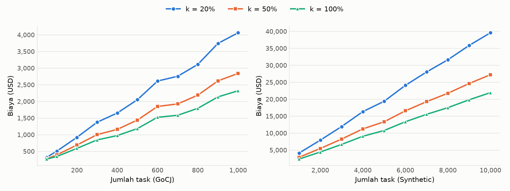

**Gambar 6.4 Biaya.** Grafik ini menunjukkan biaya CPU + RAM + bandwidth seluruh VM (USD).
*Analisis:* Biaya sejajar dengan makespan, sekitar 1.20 USD per detik makespan untuk semua k, karena ke-20 VM dihitung aktif selama simulasi. Karena itu k = 100% juga paling murah.

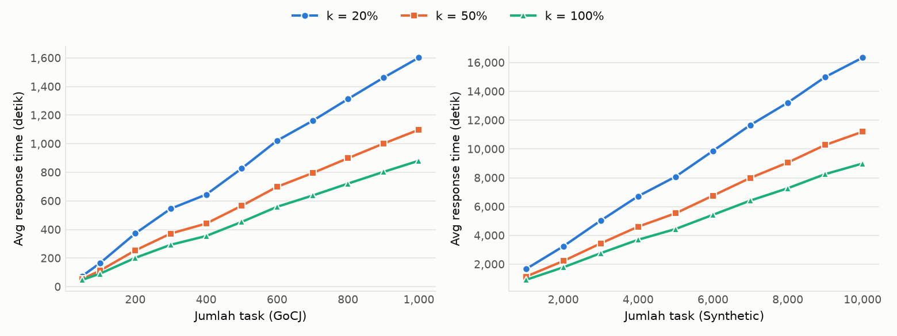

**Gambar 6.5 Avg response time.** Grafik ini menunjukkan rata-rata waktu dari task tiba (t = 0) sampai task selesai.
*Analisis:* Nilainya sekitar setengah makespan karena task selesai tersebar merata dari awal sampai akhir antrean. Bentuk grafiknya karena itu sama dengan grafik makespan.

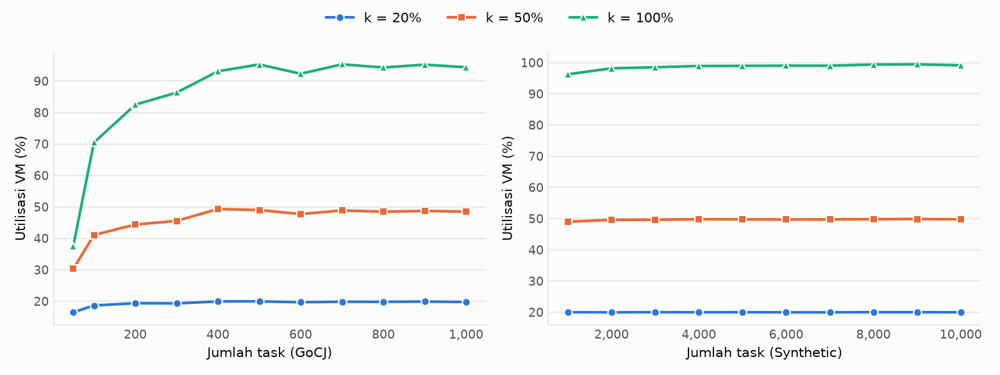

**Gambar 6.6 Utilisasi VM.** Grafik ini menunjukkan persentase waktu ke-20 VM sibuk selama makespan.
*Analisis:* Garisnya mendatar di ±20%, ±50%, dan ±99% karena k = 20% hanya memakai 4 dari 20 VM, k = 50% memakai 10 VM, dan k = 100% memakai semua VM. VM yang dipakai sibuk sampai akhir. Pada GoCJ 50 task, k = 100% lebih rendah (37.5%) karena hanya 15 VM yang mendapat task.

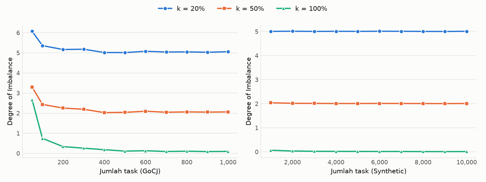

**Gambar 6.7 Degree of Imbalance (DI).** Grafik ini menunjukkan ketidakseimbangan beban antar 20 VM: (waktu selesai VM paling lama − paling cepat) / rata-rata. Makin kecil, makin seimbang.
*Analisis:* Garisnya mendatar di 5 (k = 20%) dan 2 (k = 50%) karena VM yang tidak dipakai terhitung selesai di 0 detik, sehingga DI = 20 / jumlah VM yang dipakai (20/4 = 5, 20/10 = 2). Pada k = 100% semua VM selesai hampir bersamaan, jadi DI mendekati 0.

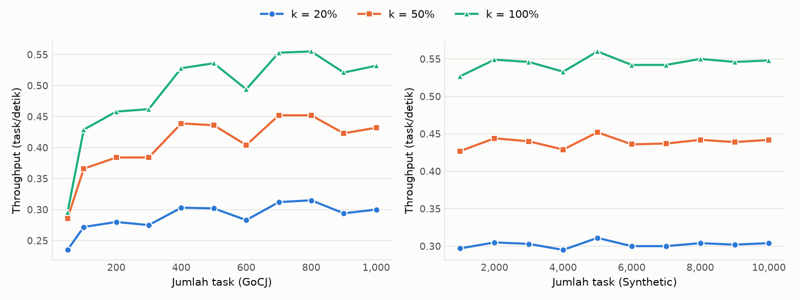

**Gambar 6.8 Throughput.** Grafik ini menunjukkan jumlah task yang selesai per detik (jumlah task / makespan).
*Analisis:* Garisnya mendatar di ±0.30, ±0.44, dan ±0.55 task/detik karena throughput ≈ kapasitas VM yang dipakai / rata-rata panjang task, sehingga tidak bergantung pada jumlah task. Garis GoCJ naik-turun mengikuti rata-rata panjang task tiap file.

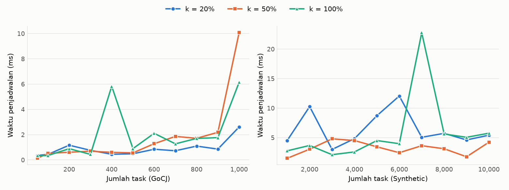

**Gambar 6.9 Waktu penjadwalan.** Grafik ini menunjukkan waktu yang dibutuhkan KPB untuk menjadwalkan semua task (milidetik, jam dinding).
*Analisis:* Garisnya naik-turun tanpa pola karena nilainya sangat kecil (0.1–23 ms) dan dipengaruhi JIT/garbage collector Java, bukan oleh nilai k. Yang penting, 10,000 task tetap terjadwal dalam ≤ 23 ms.

Grafik dan semua tabel di bagian 6.2–6.6 dibuat ulang dari `grid_summary.csv` dengan:

```bash
pip install matplotlib
python3 scripts/plot_grid.py gocj=results/sessions/cloudsim_gocj_20261009_225810 \
                             synthetic=results/sessions/cloudsim_synthetic_20261009_225854
# -> docs/figures/<metrik>.png dan docs/figures/<dataset>_tables.md
```

### 6.6 Penjelasan dengan Rumus Kapasitas

**Kunci penjelasan: subset k% selalu berisi VM yang sama.** Kecepatan VM hanya ditentukan tipenya (`ETC = L / C`), sehingga urutan VM tercepat sama untuk semua task (bagian 2.5). Akibatnya setiap k setara dengan sebuah "kolam" VM dengan kapasitas tetap:

| k | VM yang dipakai | Kapasitas kolam C |
|:---:|:---|---:|
| 20% | 4 × V3 | 40,000 MIPS |
| 50% | 4 × V3 + 6 × V2 | 58,000 MIPS |
| 100% | 4 × V3 + 8 × V2 + 8 × V1 | 72,000 MIPS |

Di dalam kolam, KPB memilih VM yang paling cepat menyelesaikan task (min CT), sehingga beban tersebar rata. Bila task cukup banyak, seluruh kolam sibuk sampai akhir dan dua rumus sederhana berlaku:

- **makespan ≈ ΣL / C**, dengan ΣL = total panjang task (MI)
- **throughput ≈ C / rata-rata L**

Tabel berikut membandingkan kedua rumus itu dengan hasil CloudSim:

**GoCJ**

| Task | Total panjang ΣL (MI) | Rata-rata L (MI) | Makespan ΣL / C (s), k = 20 / 50 / 100% | Makespan CloudSim (s) | Throughput C / rata-rata L (task/s) | Throughput CloudSim (task/s) |
|---:|---:|---:|:---:|:---:|:---:|:---:|
| 50 | 6,905,000 | 138,100 | 172.6 / 119.1 / 95.9 | 213.0 / 174.8 / 168.8 | 0.290 / 0.420 / 0.521 | 0.235 / 0.286 / 0.296 |
| 100 | 13,509,500 | 135,095 | 337.7 / 232.9 / 187.6 | 367.8 / 273.3 / 233.1 | 0.296 / 0.429 / 0.533 | 0.272 / 0.366 / 0.429 |
| 200 | 27,219,500 | 136,098 | 680.5 / 469.3 / 378.0 | 713.8 / 521.2 / 436.8 | 0.294 / 0.426 / 0.529 | 0.280 / 0.384 / 0.458 |
| 300 | 41,526,000 | 138,420 | 1,038.2 / 716.0 / 576.8 | 1,091.5 / 781.4 / 648.7 | 0.289 / 0.419 / 0.520 | 0.275 / 0.384 / 0.462 |
| 400 | 51,869,500 | 129,674 | 1,296.7 / 894.3 / 720.4 | 1,321.8 / 911.9 / 757.3 | 0.308 / 0.447 / 0.555 | 0.303 / 0.439 / 0.528 |
| 500 | 65,001,500 | 130,003 | 1,625.0 / 1,120.7 / 902.8 | 1,655.4 / 1,146.2 / 933.1 | 0.308 / 0.446 / 0.554 | 0.302 / 0.436 / 0.536 |
| 600 | 82,341,000 | 137,235 | 2,058.5 / 1,419.7 / 1,143.6 | 2,122.4 / 1,486.7 / 1,215.7 | 0.291 / 0.423 / 0.525 | 0.283 / 0.404 / 0.494 |
| 700 | 87,493,500 | 124,991 | 2,187.3 / 1,508.5 / 1,215.2 | 2,242.4 / 1,549.9 / 1,265.3 | 0.320 / 0.464 / 0.576 | 0.312 / 0.452 / 0.553 |
| 800 | 98,958,000 | 123,698 | 2,473.9 / 1,706.2 / 1,374.4 | 2,540.2 / 1,769.2 / 1,440.1 | 0.323 / 0.469 / 0.582 | 0.315 / 0.452 / 0.555 |
| 900 | 120,047,000 | 133,386 | 3,001.2 / 2,069.8 / 1,667.3 | 3,065.6 / 2,127.5 / 1,725.9 | 0.300 / 0.435 / 0.540 | 0.294 / 0.423 / 0.521 |
| 1,000 | 129,662,000 | 129,662 | 3,241.6 / 2,235.6 / 1,800.9 | 3,331.3 / 2,313.6 / 1,880.2 | 0.308 / 0.447 / 0.555 | 0.300 / 0.432 / 0.532 |

**Synthetic**

| Task | Total panjang ΣL (MI) | Rata-rata L (MI) | Makespan ΣL / C (s), k = 20 / 50 / 100% | Makespan CloudSim (s) | Throughput C / rata-rata L (task/s) | Throughput CloudSim (task/s) |
|---:|---:|---:|:---:|:---:|:---:|:---:|
| 1,000 | 132,584,000 | 132,584 | 3,314.6 / 2,285.9 / 1,841.4 | 3,368.7 / 2,342.9 / 1,898.6 | 0.302 / 0.437 / 0.543 | 0.297 / 0.427 / 0.527 |
| 2,000 | 257,551,500 | 128,776 | 6,438.8 / 4,440.5 / 3,577.1 | 6,555.5 / 4,509.2 / 3,641.6 | 0.311 / 0.450 / 0.559 | 0.305 / 0.444 / 0.549 |
| 3,000 | 389,238,000 | 129,746 | 9,731.0 / 6,711.0 / 5,406.1 | 9,889.1 / 6,813.4 / 5,498.4 | 0.308 / 0.447 / 0.555 | 0.303 / 0.440 / 0.546 |
| 4,000 | 533,816,000 | 133,454 | 13,345.4 / 9,203.7 / 7,414.1 | 13,569.8 / 9,318.3 / 7,508.9 | 0.300 / 0.435 / 0.540 | 0.295 / 0.429 / 0.533 |
| 5,000 | 633,350,000 | 126,670 | 15,833.8 / 10,919.8 / 8,796.5 | 16,102.8 / 11,067.1 / 8,921.4 | 0.316 / 0.458 / 0.568 | 0.311 / 0.452 / 0.560 |
| 6,000 | 787,098,000 | 131,183 | 19,677.5 / 13,570.7 / 10,931.9 | 20,023.9 / 13,757.3 / 11,076.0 | 0.305 / 0.442 / 0.549 | 0.300 / 0.436 / 0.542 |
| 7,000 | 916,815,000 | 130,974 | 22,920.4 / 15,807.2 / 12,733.5 | 23,318.0 / 16,024.6 / 12,906.1 | 0.305 / 0.443 / 0.550 | 0.300 / 0.437 / 0.542 |
| 8,000 | 1,035,889,500 | 129,486 | 25,897.2 / 17,860.2 / 14,387.4 | 26,319.9 / 18,083.0 / 14,541.6 | 0.309 / 0.448 / 0.556 | 0.304 / 0.442 / 0.550 |
| 9,000 | 1,174,900,000 | 130,544 | 29,372.5 / 20,256.9 / 16,318.1 | 29,835.2 / 20,484.5 / 16,479.3 | 0.306 / 0.444 / 0.552 | 0.302 / 0.439 / 0.546 |
| 10,000 | 1,295,258,000 | 129,526 | 32,381.5 / 22,332.0 / 17,989.7 | 32,947.1 / 22,637.5 / 18,233.2 | 0.309 / 0.448 / 0.556 | 0.304 / 0.442 / 0.548 |

Untuk Synthetic dan GoCJ ≥ 400 task, CloudSim hanya 1–4% di atas rumus kapasitas, sehingga bentuk grafik 6.1–6.8 bisa diturunkan langsung dari kedua rumus ini. Makespan naik lurus dengan kemiringan rata-rata L / C (±3.3, ±2.3, dan ±1.8 detik per task untuk k = 20%, 50%, 100%). Throughput mendatar di C / rata-rata L. Selisih makespan mendatar di 1 − C(20%) / C(k). Pada task sedikit (GoCJ 50–300), rumus ini meleset jauh (GoCJ 50, k = 100%: CloudSim 168.8 s vs rumus 95.9 s) karena beban tidak bisa dibagi rata: satu task 900,000 MI saja sudah butuh 90 s di VM tercepat.

### 6.7 Analisis Grafik

Kesembilan grafik di bagian 6.5 dapat dibaca sebagai satu cerita: **semua metrik dikendalikan oleh kapasitas kolam VM yang dibuka oleh k** (40,000 / 58,000 / 72,000 MIPS), bukan oleh jenis dataset.

| Kelompok grafik | Pola | Arti |
|:---|:---|:---|
| Makespan, energi, biaya, avg response time (6.1, 6.3, 6.4, 6.5) | Naik lurus terhadap jumlah task; jarak antar garis k makin lebar | Metrik "total" ini sebanding dengan ΣL / C, jadi keuntungan k besar bertambah seiring beban |
| Selisih makespan, utilisasi, DI, throughput (6.2, 6.6, 6.7, 6.8) | Mendatar di nilai tetap per k | Metrik "rasio" ini hanya ditentukan berapa VM yang dipakai (4 / 10 / 20 VM), tidak bergantung jumlah task |
| Waktu penjadwalan (6.9) | Acak, 0.1–23 ms | Overhead KPB dapat diabaikan (< 0.001% dari makespan) |

- **Urutan k konsisten.** Di 8 grafik metrik kinerja, k = 100% selalu terbaik, disusul 50% lalu 20%, pada seluruh 21 ukuran dataset. Tidak ada garis yang bersilangan.
- **Besar keunggulan dapat diprediksi.** Dibanding k = 20%, k = 100% memangkas makespan ±44%, response time ±45%, biaya ±43–45%, dan energi ±37–38%, serta menaikkan throughput ±77–81% (untuk ≥ 400 task). Energi turun paling sedikit karena daya idle host dan energi kerja task tetap sama untuk semua k.
- **Tidak ada trade-off.** Konsolidasi (k kecil) tidak menghemat energi maupun biaya, karena keenam host dan ke-20 VM tetap dihitung menyala; makespan yang lebih panjang justru menambah keduanya.
- **GoCJ dan Synthetic memberi kesimpulan yang sama.** Penyimpangan hanya muncul di GoCJ kecil (50–300 task), ketika beberapa task raksasa mendominasi makespan sehingga keunggulan k = 100% mengecil, serta "tangga" GoCJ akibat total MI tiap file tidak sebanding dengan jumlah task-nya. Pada Synthetic semua garis mulus.
- **Kesimpulan:** pada desain dengan heterogenitas VM konsisten ini, k = 100% adalah pilihan terbaik untuk semua metrik; membatasi k hanya mengurangi kapasitas yang boleh dipakai tanpa memberi keuntungan apa pun.

---

## 7. Implementasi Real-World

Di simulasi, CloudSim *menghitung* eksekusi cloudlet. Di real world, task GoCJ yang sama **benar-benar dieksekusi** di 20 container Docker, lalu makespan diukur dengan jam dinding (wall-clock). Infrastruktur container mengikuti Desain bagian 2 dan penempatan VM hasil CloudSim.

### 7.1 Arsitektur

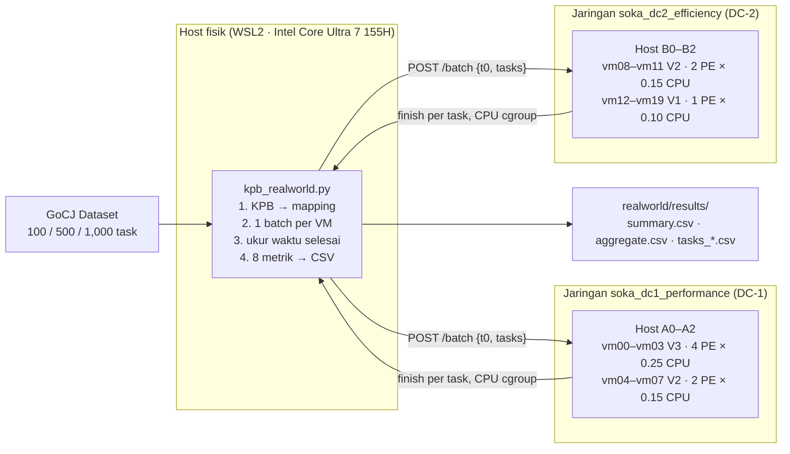

| Komponen | File | Peran |
|:---|:---|:---|
| 20 "VM" | [`realworld/docker-compose.yml`](realworld/docker-compose.yml) | Container `python:3.12-slim`. Batas CPU, jumlah PE, RAM, jaringan DC, dan label host sesuai desain |
| Worker | [`realworld/worker/worker.py`](realworld/worker/worker.py) | Server HTTP di tiap container dengan `PES` proses PE yang meniru `CloudletSchedulerTimeShared` |
| Runner | [`realworld/kpb_realworld.py`](realworld/kpb_realworld.py) | Mengambil mapping KPB dari kode Java yang sama dengan simulasi, mengeksekusinya, 8 metrik desain, repetisi, ekspor CSV |

### 7.2 Pemetaan Simulasi → Real World

| Konsep desain / CloudSim | Real world |
|:---|:---|
| Skala MIPS | 1.0 CPU container = 10,000 MIPS |
| VM V3 (4 PE × 2,500) | Container 1.0 CPU dengan 4 proses PE, masing-masing ≤ 0.25 CPU |
| VM V2 (2 PE × 1,500) | Container 0.3 CPU dengan 2 proses PE, masing-masing ≤ 0.15 CPU |
| VM V1 (1 PE × 1,000) | Container 0.1 CPU dengan 1 proses PE |
| RAM VM (8 / 4 / 2 GB) | `mem_limit` container 8g / 4g / 2g |
| DC-1 / DC-2 | Jaringan Docker `soka_dc1_performance` / `soka_dc2_efficiency` |
| Host & penempatan VM | Label `soka.host`, sama dengan `results/simulation/placement.csv` (dicek otomatis setiap run) |
| Cloudlet 1 PE, `L_i` MI | `L_i × 14` iterasi CPU, dikerjakan oleh **satu** PE pada satu waktu |
| `CloudletSchedulerTimeShared` | Semua task di satu VM aktif bersamaan dan bergiliran per *chunk* (50,000 iterasi) di PE yang tersedia |
| Makespan, response time | Waktu selesai task (jam *monotonic* bersama host–container) dihitung dari t0 batch |
| Energi (`PowerModelHostSimple`) | Model daya desain diterapkan pada CPU yang **diukur** dari cgroup tiap container, dikelompokkan per host |
| Biaya (`VmCost`) | Rumus yang sama dengan CloudSim, dengan umur VM = makespan nyata |

Tiga hal yang membuat eksekusinya nyata, bukan sekadar meniru durasi:

1. **Beban berbasis jumlah kerja.** Worker tidak diberi tahu berapa lama harus berjalan. Jumlah iterasi task sama di container mana pun, dan perbedaan waktu berasal dari batas CPU kernel (CFS, `cpu_quota` dengan periode 10 ms) serta batas per PE.
2. **Batas 1 PE per task pada worker Docker.** Satu task dijalankan oleh satu proses PE; V3 dapat mengerjakan hingga empat task berbeda bersamaan, tetapi satu task tidak memakai keempat PE. Ini berbeda dari CloudSim terbaru, yang memberi satu Cloudlet semua PE VM tujuannya.
3. **Mapping identik dengan simulasi.** Algoritma tidak ditulis ulang di Python: `kpb_realworld.py` memanggil `project.Experiment --no-sim --export-mapping` (atau membaca JSON hasil ekspor lewat `--mapping`), jadi mapping real-world selalu berasal dari kode Java yang sama dengan CloudSim.

### 7.3 Cara Menjalankan

#### Langkah 1: Cek prasyarat

| Software | Cek | Keterangan |
|:---|:---|:---|
| Docker Engine | `docker version` | Bagian **Server** harus muncul. Kalau tidak, Docker daemon belum jalan |
| Docker Compose v2 | `docker compose version` | Sudah termasuk di Docker Desktop / Docker Engine terbaru |
| Python 3.8+ | `python3 --version` | Hanya standard library, **tidak perlu** `pip install` |

Pengguna WSL: buka Docker Desktop di Windows dulu (pastikan *WSL integration* aktif), atau jalankan `sudo service docker start` bila Docker diinstal langsung di WSL.

#### Langkah 2: (Disarankan) jalankan simulasi dulu

```bash
cd soka-a-5
mvn -q exec:java -Dexec.args="src/main/resources/dataset/GoCJ_Dataset_100.txt"
```

Langkah ini membuat `results/simulation/placement.csv`, yang dipakai real world untuk memverifikasi bahwa penempatan VM sama dengan CloudSim.

#### Langkah 3: Masuk ke folder `realworld/` dan nyalakan 20 container

```bash
cd realworld
docker compose up -d
```

Saat pertama kali, Docker mengunduh image `python:3.12-slim` (±50 MB). Bila sebelumnya sudah memakai versi lama compose ini, jalankan `docker compose up -d --force-recreate`.

#### Langkah 4: Pastikan semua container siap

```bash
docker ps --filter name=kpb_vm --format '{{.Names}}  {{.Status}}'   # harus 20 baris "Up"
curl http://127.0.0.1:9100/health
# {"vm": "vm00", "pes": 4, "pe_share": 0.25, "status": "ok"}
curl http://127.0.0.1:9119/health
# {"vm": "vm19", "pes": 1, "pe_share": 0.1, "status": "ok"}
```

#### Langkah 5: Uji coba cepat (±15 detik)

```bash
python3 kpb_realworld.py --limit 20 --repeat 1 --out results_demo
```

Selama berjalan, terminal menampilkan **log broker real-time**. Setiap baris muncul saat cloudlet benar-benar selesai di container-nya. Angka di kiri adalah detik sejak batch dikirim:

```text
scheduler=KPB(k=20.0%) realworld, placement cocok dengan CloudSim
dataset=../src/main/resources/dataset/GoCJ_Dataset_100.txt tasks=20 subset=4 repeat=1 itersPerMI=14 scale=0.0328
[run 1/1] menjalankan task di container... (prediksi analitik ±2.9 s)
     0.00: Broker: Mengirim Cloudlet #0 (127000 MI) ke vm00 (V3) di DC-1/Host A0
     0.00: Broker: Mengirim Cloudlet #1 (83000 MI) ke vm01 (V3) di DC-1/Host A1
     ...
     0.31: Broker: Cloudlet #5 selesai di vm03 (V3) di DC-1/Host A0, diterima broker
     0.31: Broker: Jumlah cloudlet selesai: 1/20
     0.49: Broker: Cloudlet #9 selesai di vm02 (V3) di DC-1/Host A2, diterima broker
     0.49: Broker: Jumlah cloudlet selesai: 2/20
     ...
     1.27: Broker: vm00 (V3) selesai: 4 cloudlet, CPU terpakai 1.11 s
     7.64: Broker: Cloudlet #11 selesai di vm02 (V3) di DC-1/Host A2, diterima broker
     7.64: Broker: Jumlah cloudlet selesai: 20/20
     7.65: Broker: vm02 (V3) selesai: 4 cloudlet, CPU terpakai 2.44 s
     7.64: Broker: Semua cloudlet selesai (20/20). Finishing...
  makespan=7.641s, energy=0.001620 kWh, ..., vmsUsed=4/20
```

| Baris log | Artinya |
|:---|:---|
| `Mengirim Cloudlet #i (L MI) ke vmXX (tipe) di DC-d/Host h` | Keputusan KPB: task i dikirim ke VM pilihan KPB, lengkap dengan DC dan host-nya |
| `Cloudlet #i selesai di vmXX ..., diterima broker` | Task i selesai dieksekusi di container dan hasilnya kembali ke runner |
| `Jumlah cloudlet selesai: x/N` | Progres keseluruhan |
| `vmXX (tipe) selesai: n cloudlet, CPU terpakai c s` | Semua task di VM itu selesai; CPU diukur dari cgroup container |
| `Semua cloudlet selesai (N/N). Finishing...` | Run selesai, lalu metrik dihitung |

Waktu selesai diukur di dalam container, jadi pencetakan log tidak memengaruhi metrik. Log bisa dimatikan dengan `--quiet`.

Kalau muncul `placement cocok dengan CloudSim`, `Semua cloudlet selesai`, dan baris `makespan=...`, setup sudah benar. Folder `results_demo/` boleh dihapus setelahnya.

#### Langkah 6: Jalankan skenario

Format: `python3 kpb_realworld.py --dataset <file GoCJ> --k <persen> --repeat <N>`

```bash
# S1, 1 repetisi (±15 detik)
python3 kpb_realworld.py --dataset ../src/main/resources/dataset/GoCJ_Dataset_100.txt --k 20 --repeat 1

# S2: 500 task, k = 50%, 3 repetisi (±3 menit)
python3 kpb_realworld.py --dataset ../src/main/resources/dataset/GoCJ_Dataset_500.txt --k 50

# S3: 1.000 task, k = 100%, 3 repetisi (±6–7 menit)
python3 kpb_realworld.py --dataset ../src/main/resources/dataset/GoCJ_Dataset_1000.txt --k 100
```

**Grid real-world GoCJ 50–1,000** (11 ukuran × 3 k × 3 repetisi = 99 run, urutan acak, `scale` dan `itersPerMI` dikunci, `docker stats` direkam, lalu direkap oleh `analyze_grid.py`):

```bash
bash run_grid.sh                                  # GoCJ 50..1000, 3 repetisi (beberapa jam)
SOURCE=synthetic bash run_grid.sh                 # Synthetic 1000 / 5000 / 10000, 1 repetisi
SCENARIOS="100 200" REPS=1 bash run_grid.sh       # sebagian
```

Skrip menolak berjalan bila Windows tidak dalam mode daya "Best performance" dengan charger terpasang (`FORCE=1` untuk melewati), karena kecepatan core laptop bisa berubah hingga ±50% antar mode daya.

Seluruh 9 kombinasi S1–S3 × 3 repetisi, sama seperti tabel 7.4 (±30 menit). `--quiet` dipakai supaya log tidak berisi ribuan baris per cloudlet:

```bash
SESSION=results/sessions/kpb_$(date +%Y%m%d_%H%M%S)    # satu folder baru per sesi, hasil lama tidak disentuh
mkdir -p $SESSION
for n in 100 500 1000; do for k in 20 50 100; do
  echo "== GoCJ $n task, k = $k% =="
  python3 kpb_realworld.py --dataset ../src/main/resources/dataset/GoCJ_Dataset_$n.txt --k $k --repeat 3 --quiet \
    --out $SESSION | tee $SESSION/log_GoCJ_Dataset_${n}_k$k.txt
done; done
```

Selama berjalan, penggunaan CPU per container bisa dipantau dari terminal lain (tekan `Ctrl+C` untuk keluar):

```bash
# dari folder realworld/
docker compose stats

# atau dari folder mana pun
docker stats $(docker ps -q --filter name=kpb_vm)
```

Saat semua VM sibuk, kolom `CPU %` akan menunjukkan sekitar 100% untuk V3 (vm00–vm03), ~30% untuk V2 (vm04–vm11), dan ~10% untuk V1 (vm12–vm19), sesuai batas CPU masing-masing.

#### Langkah 7: Lihat hasil

```bash
column -s, -t $SESSION/aggregate.csv | less -S    # mean ± std per konfigurasi
column -s, -t $SESSION/summary.csv | less -S      # satu baris per run
```

| File | Isi |
|:---|:---|
| `aggregate.csv` | Satu baris per konfigurasi: mean dan std 8 metrik |
| `summary.csv` | Satu baris per run: 8 metrik, skala, prediksi analitik |
| `tasks_<dataset>_n<N>_k<K>_run<R>.csv` | Per task: VM, tipe, DC, host, waktu selesai |
| `mapping_<dataset>.json` | Mapping yang dieksekusi, hasil ekspor Java |
| `log_<dataset>_k<K>.txt` | Salinan output terminal (bila memakai loop di atas) |

Semua file di atas ada di folder sesi (`--out`, default `results/sessions/kpb_<timestamp>/`). Hasil lama di `results/*.csv` tidak pernah ditimpa.

#### Langkah 8: Mapping sama dengan simulasi

Mapping dihitung oleh `project.Experiment` (Java), kode yang sama dengan simulasi CloudSim, lalu disimpan di `mapping_<dataset>.json` di folder sesi. Python hanya mengeksekusinya, sehingga mapping simulasi dan real-world identik secara konstruksi. Untuk memakai mapping yang sama persis di beberapa sesi, ekspor sekali lalu berikan lewat `--mapping`:

```bash
# dari root repo
mvn -q compile exec:java -Dexec.args="--dataset src/main/resources/dataset/GoCJ_Dataset_500.txt --k 50 --no-sim --export-mapping realworld/kpb_500_k50.json"
cd realworld && python3 kpb_realworld.py --dataset ../src/main/resources/dataset/GoCJ_Dataset_500.txt --mapping kpb_500_k50.json
```

#### Langkah 9: Matikan container

```bash
docker compose down
```

#### Troubleshooting

| Masalah | Penyebab / solusi |
|:---|:---|
| `[ERROR] vm00 (http://127.0.0.1:9100) tidak merespons` | Container belum jalan. Lakukan langkah 3–4, tunggu beberapa detik, lalu ulangi |
| `[ERROR] vm00 masih memakai worker versi lama (model paralel per-PE, ...)` | Container belum memuat `worker.py` sekuensial. Jalankan `docker compose up -d --force-recreate` |
| `[ERROR] Penjadwalan Java gagal` | `mvn`/JDK tidak ada di PATH, atau kode Java gagal dikompilasi. Coba `mvn -q compile` dari root repo |
| `[ERROR] .../summary.csv punya kolom berbeda` | Folder `--out` berisi CSV format lama. Pakai folder sesi baru |
| `[ERROR] Penempatan vmXX beda dengan CloudSim` | Konfigurasi simulasi berubah. Samakan `PLACEMENT` di `kpb_realworld.py` dengan `results/simulation/placement.csv` |
| `Cannot connect to the Docker daemon` | Docker belum dinyalakan (lihat langkah 1) |
| `port is already allocated` (9100–9119) | Port dipakai program lain. Matikan program itu, atau ganti port di `docker-compose.yml` dan `kpb_realworld.py` |
| Makespan jauh lebih lama dari tabel 7.4 | Laptop sedang sibuk, panas, atau dalam mode hemat daya. Tutup aplikasi berat, colokkan charger, lalu ulangi |

#### Argumen `kpb_realworld.py`

| Argumen | Default | Arti |
|:---|:---:|:---|
| `--dataset` | GoCJ 100 | File dataset GoCJ |
| `--k` | 20 | Persen VM kandidat KPB (mapping dihitung oleh Java) |
| `--mapping` | — | Pakai JSON mapping yang sudah diekspor Java (`--k` diabaikan) |
| `--repeat` | 3 | Jumlah repetisi (mean ± std dihitung otomatis) |
| `--iters-per-mi` | 14 | Iterasi CPU per MI (beban per task) |
| `--scale` | kalibrasi | Kunci skala detik-nyata/detik-simulasi |
| `--limit` | 0 (semua) | Hanya pakai N task pertama |
| `--out` | `results/sessions/kpb_<timestamp>` | Folder sesi |
| `--placement` | `../results/simulation/placement.csv` | File penempatan CloudSim untuk verifikasi |
| `--quiet` | mati | Sembunyikan log broker real-time per cloudlet |
| `--first-run` | 1 | Nomor run pertama (agar repetisi dari beberapa pemanggilan tidak saling timpa) |
| `--calibrate-only` | mati | Cetak `scale` hasil kalibrasi lalu keluar |

Contoh output dengan `--quiet` (S2, k = 50%):

```text
scheduler=KPB(k=50.0%) realworld, placement cocok dengan CloudSim
dataset=../src/main/resources/dataset/GoCJ_Dataset_500.txt tasks=500 subset=10 repeat=3 itersPerMI=14 scale=0.0247
[run 1/3] menjalankan task di container... (prediksi analitik ±28.1 s)
  makespan=59.462s, energy=0.014849 kWh, avgResponse=36.502s, utilization=44.64%, DI=2.2401 (VM terpakai 0.1661), throughput=8.409 task/s, cost=$136.63, schedulingTime=1.464 ms, vmsUsed=10/20
[run 2/3] ...
[run 3/3] ...
rata-rata ± std dari 3 run:
  makespan_s              57.0923 ± 2.0882
  energy_kwh               0.0143 ± 0.0005
  avg_response_s          35.6022 ± 0.9000
  utilization_pct         45.5596 ± 0.7990
  di_all_vm                2.1954 ± 0.0389
  di_used_vm               0.1423 ± 0.0219
  throughput_task_s        8.7654 ± 0.3150
  cost_usd               133.7908 ± 2.5059
  scheduling_ms            1.9813 ± 0.4500
```

- `scale`: 1 detik simulasi = `scale` detik nyata, dari kalibrasi 1 PE V3 sebelum run.
- `prediksi analitik`: makespan rumus f1 × `scale`.
- `energy`: model daya desain diterapkan pada CPU terukur, untuk 6 host selama makespan nyata.
- `cost`: rumus `VmCost` CloudSim dengan umur VM = makespan nyata.

### 7.4 Hasil Ujicoba Real-World

**Environment:** Docker 29.8 di WSL2, Intel Core Ultra 7 155H (6 P-core + 8 E-core + 2 LP-E core, 22 thread), 8 GB RAM. Nilai berikut adalah hasil run final (1 run per konfigurasi, dijalankan berurutan dalam satu sesi). Semua task selesai tanpa kegagalan, dan penempatan VM selalu cocok dengan CloudSim. Data mentah ada di [`realworld/results/aggregate.csv`](realworld/results/aggregate.csv) (baris dengan `runs=1`, 2026-10-03).

> Pengujian awal memakai 3 repetisi per konfigurasi untuk mendapat std; hasilnya stabil di S1–S2 tapi tidak stabil di S3 (std makespan sampai ±23.5 s) akibat thermal throttling laptop. Tabel di bawah ini adalah run susulan yang paling valid, dilakukan setelah itu dalam kondisi laptop lebih terkontrol. Data 3 repetisi awal tetap ada di `aggregate.csv` (baris `runs=3`) dan dibahas di bagian 7.7 (Anomali).

| Skenario | k | Makespan (s) | Energi (kWh) | Avg response (s) | Utilisasi | DI (semua VM / terpakai) | Throughput (task/s) | Biaya (USD) | Waktu penjadwalan |
|:---:|:---:|---:|---:|---:|---:|:---:|---:|---:|---:|
| S1 (100) | 20% | 15.02 | 0.00344 | 5.77 | 18.8% | 5.31 / 0.17 | 6.66 | 83.31 | 0.61 ms |
| S1 (100) | 50% | **12.25** | **0.00287** | 5.00 | 33.7% | 2.97 / 0.80 | 8.16 | **79.98** | 0.63 ms |
| S1 (100) | 100% | 13.27 | 0.00310 | **4.31** | 44.1% | 1.67 / 1.67 | 7.54 | 81.20 | 0.61 ms |
| S2 (500) | 20% | 53.90 | 0.01276 | 26.53 | 18.6% | 5.38 / 0.11 | 9.28 | 129.96 | 2.58 ms |
| S2 (500) | 50% | 50.26 | 0.01262 | 29.86 | 45.1% | 2.22 / 0.16 | 9.95 | 125.59 | 1.70 ms |
| S2 (500) | 100% | **42.09** | **0.01097** | 26.45 | 86.0% | 0.27 / 0.27 | 11.88 | **115.79** | 2.89 ms |
| S3 (1,000) | 20% | 106.90 | 0.02556 | 58.98 | 19.3% | 5.19 / 0.06 | 9.35 | 193.55 | 5.50 ms |
| S3 (1,000) | 50% | 96.61 | 0.02449 | 61.47 | 47.2% | 2.12 / 0.08 | 10.35 | 181.21 | 7.23 ms |
| S3 (1,000) | 100% | **80.74** | **0.02139** | **55.26** | 91.8% | 0.13 / 0.13 | **12.38** | **162.17** | 7.10 ms |

DI dihitung dua cara: atas seluruh 20 VM (sesuai definisi desain, dipakai di bagian 6.2–6.3) dan hanya atas VM yang terpakai (dalam kurung di output program). Pada k = 100%, keduanya sama karena semua VM terpakai. Energi dan biaya di real world dihitung untuk durasi nyata (detik), jauh lebih kecil daripada simulasi (berskala ±40× lebih lama) — yang bisa dibandingkan adalah **trennya**, bukan angka mutlaknya.

**Real world vs CloudSim.** Prediksi = makespan analitik f1 (lihat kolom CloudSim / analitik, tabel 6.4) × `scale`, karena real world tidak meniru RAM/BW 20% per task (lihat 7.6).

| Skenario | k | Prediksi dari CloudSim (s) | Nyata (s) | Nyata / prediksi | Proses PE aktif |
|:---:|:---:|---:|---:|:---:|:---:|
| S1 (100) | 20% | 11.8 | 15.02 | 1.27× | 16 |
| S1 (100) | 50% | 9.5 | 12.25 | 1.29× | 28 |
| S1 (100) | 100% | 7.6 | 13.27 | 1.74× | 40 |
| S2 (500) | 20% | 54.5 | 53.90 | 0.99× | 16 |
| S2 (500) | 50% | 35.1 | 50.26 | 1.43× | 28 |
| S2 (500) | 100% | 28.2 | 42.09 | 1.49× | 40 |
| S3 (1,000) | 20% | 105.8 | 106.90 | 1.01× | 16 |
| S3 (1,000) | 50% | 77.3 | 96.61 | 1.25× | 28 |
| S3 (1,000) | 100% | 62.2 | 80.74 | 1.30× | 40 |

**Grid real-world GoCJ 50–1,000 (feedback).** Sesi `realworld/results/sessions/gocj_20261009_230602/` (`run_grid.sh`, 99 run) berhenti setelah 37 run, sehingga sebagian sel belum punya data. Karena itu hasilnya belum ditampilkan di sini; hasil feedback (GoCJ 50–1,000 dan Synthetic 1,000–10,000) saat ini berasal dari CloudSim (bagian 6).

### 7.5 Analisis Real-World

1. **Perilaku KPB terkonfirmasi.** Jumlah VM terpakai selalu sama dengan `s = ⌈k% × 20⌉` (utilisasi ~19% / ~45% / ~90% pada S2–S3), dan DI atas VM terpakai kecil untuk k = 20–50% (0.06–0.80). Penempatan VM, batas PE, dan time-sharing berjalan seperti di CloudSim.
2. **k = 100% paling cepat di S2 dan S3, sejalan dengan simulasi (bagian 6.2 dan 6.6).** Di S2, 21.9% lebih cepat dari k = 20% (42.09 s vs 53.90 s); di S3, 24.5% lebih cepat (80.74 s vs 106.90 s). Energi, biaya, dan throughput juga paling baik di k = 100% pada kedua skenario itu.
3. **Pada S1, k = 50% justru sedikit lebih cepat dari k = 100%** (12.25 s vs 13.27 s) — kebalikan dari simulasi, yang tetap menunjukkan k = 100% tercepat (233.08 s vs 273.35 s pada k = 50%). Penyebabnya adalah efek penempatan pada task raksasa, bukan k = 50% yang lebih baik secara umum (lihat 7.7, bagian Anomali).
4. **Rasio nyata/prediksi naik seiring makin banyak proses PE aktif** (16 → 28 → 40), dari ±1.0–1.3× menjadi ±1.3–1.7×. Laptop memakai CPU hybrid; makin banyak proses aktif, makin banyak yang terpaksa berjalan di E-core dan LP-E core yang lebih lambat. Overhead ini **tidak sampai membalik urutan** pada run final, berbeda dengan pengujian 3-repetisi awal di S3 yang sempat kena thermal throttling (lihat 7.7, bagian Anomali) — bukti bahwa overhead CPU hybrid konsisten ada, tapi besarnya bergantung kondisi laptop saat itu.
5. **Biaya dan energi mengikuti makespan.** Karena semua VM dan host dihitung menyala selama makespan, konfigurasi yang paling cepat selalu paling hemat energi dan biaya. Kesimpulannya sama dengan simulasi (bagian 6.6).
6. **Waktu penjadwalan tetap kecil.** KPB di Python menjadwalkan 1,000 task dalam ~5–7 ms.

### 7.6 Batasan Real-World

- **Container adalah proksi VM, dan host hanyalah label.** Ke-20 container berbagi satu CPU laptop, sehingga ada interferensi (P-core vs E-core, thermal) yang tidak ada di CloudSim.
- **RAM/BW 20% per task tidak ditiru.** Meniru 20% RAM VM per task (V3: 1.6 GB × ratusan task bersamaan) mustahil di laptop 8 GB. Karena itu, pembanding yang adil adalah makespan analitik f1 (tabel 6.4), bukan hasil CloudSim utama.
- **Bandwidth dan transfer file 300 KB tidak ditiru.** Container tidak dibatasi bandwidth jaringannya.
- **Energi adalah estimasi**: model daya desain diterapkan pada CPU terukur dari cgroup. Tidak ada power meter atau RAPL di WSL2.
- **Repetisi**: tabel 7.4 memakai 1 run per konfigurasi (run final, paling valid). Pengujian awal memakai 3 repetisi (bukan 10× seperti protokol desain, supaya selesai dalam ±30 menit), yang mengungkap ketidakstabilan di S3 — dibahas di 7.7.

### 7.7 Kesimpulan Real-World

Ringkasan dari hasil 7.4, ditambah dua temuan yang tidak langsung terlihat dari tabel saja: cara k memengaruhi jumlah VM yang dipakai, dan anomali yang ditemukan selama pengujian.

#### Cara kerja singkat

- Untuk setiap task, KPB mengambil **k% VM tercepat** sebagai kandidat, lalu memilih VM yang **paling cepat menyelesaikan task tersebut** (memperhitungkan antrean).
- Kecepatan VM hanya ditentukan oleh tipenya (V1/V2/V3), jadi urutan VM tercepat selalu sama untuk semua task. Akibatnya, k pada dasarnya hanya menentukan **berapa banyak VM yang boleh dipakai**:
  - k = 20% → 4 VM (semua V3)
  - k = 50% → 10 VM (V3 + sebagian V2)
  - k = 100% → 20 VM (semua VM, sama dengan algoritma MCT)

#### Temuan utama

- Pada **500 dan 1000 task** (tabel 7.4), k = 100% selalu paling cepat: **21.9%** dan **24.5%** lebih cepat dari k = 20%.
- Keunggulan k = 100% **makin besar saat task makin banyak**. Antrean di V3 jadi panjang, jadi lebih efisien kalau V2 dan V1 ikut bekerja walaupun lebih lambat (seperti membuka semua kasir supermarket, bukan hanya kasir tercepat).
- **Energi dan cost ikut turun**, tetapi itu karena makespan lebih pendek (semua host tetap menyala selama pengujian), bukan keunggulan terpisah.
- Pola hasil real-world **sejalan dengan simulasi CloudSim**, dan penempatan task identik di kedua fase karena memakai kode scheduler yang sama (bagian 7.3 Langkah 8).

#### Anomali

- **100 task: k = 50% lebih cepat dari k = 100%.** Dengan task sedikit, makespan ditentukan oleh beberapa task raksasa (900,000 MI). Di k = 100%, task 900,000 MI kebetulan berjalan sendirian di akhir sehingga paling lama selesai. Ini efek penempatan, bukan karena k = 50% lebih baik, dan polanya hilang di 500/1000 task.
- **Model satu-PE tetap berlaku untuk runner Docker, bukan CloudSim.** Worker Docker menjalankan satu task pada satu PE; karena itu V3 dapat menyisakan PE ketika task yang aktif kurang dari empat. Di CloudSim masalah satu-PE sudah diperbaiki: setiap Cloudlet memakai seluruh PE VM tujuan. Grid CloudSim (63 run) menunjukkan makespan hanya 0.4–1.8% di atas f1 (bagian 6.4).
- **Pengujian awal (3 repetisi) untuk 1000 task tidak stabil** (std makespan sampai ±23.5 s, urutan sempat tidak sesuai teori — data ini ada di `realworld/results/aggregate.csv` baris `runs=3`, bukan di tabel 7.4). Setelah diuji ulang dalam kondisi laptop yang lebih terkontrol (tabel 7.4, baris `runs=1`), hasilnya kembali sesuai teori. Dugaan penyebab: beban laptop, suhu, dan CPU hybrid (core cepat + core lambat) — lihat bagian 7.6.
- **Keunggulan k = 100% lebih kecil dari teori** (1.3× di S3 vs perkiraan ~2× berdasarkan rasio MIPS). Dugaan: saat 20 container aktif bersamaan, sebagian tetap berjalan di core laptop yang lebih lambat (lihat rasio nyata/prediksi di tabel 7.4, naik seiring jumlah proses PE aktif). Artinya hasil ini cenderung **konservatif** — di infrastruktur fisik sungguhan (bukan laptop berbagi satu CPU), keunggulan k = 100% kemungkinan lebih besar lagi.

#### Kesimpulan

- KPB berjalan benar di real world; tren k = 100% untuk beban besar sejalan dengan simulasi, tetapi angka Docker tetap dipengaruhi CPU laptop dan model satu-PE per task.
- Anomali V3 satu-PE di CloudSim sudah tidak terjadi setelah Cloudlet memakai seluruh PE VM dan `SpaceShared`; hasil 3×3 kini dekat dengan analitik.
- Pada desain infrastruktur ini, **k = 100% adalah pilihan terbaik**, terutama untuk jumlah task besar.
- k kecil hanya membatasi VM yang boleh dipakai tanpa memberi keuntungan, karena VM tercepat selalu sama untuk semua task.
- Pada beban kecil, perbedaan antar k tidak bisa dijadikan patokan karena dipengaruhi penempatan beberapa task raksasa.

---

## 8. Panduan Menjalankan Sim

### Prasyarat

| Software | Versi | Cek |
|:---|:---:|:---|
| Java JDK | 11+ | `java -version` |
| Maven | 3.8+ | `mvn -version` |
| Docker + Compose | 20+ / v2+ | `docker compose version` (khusus real world) |
| Python | 3.8+ | `python3 --version` (khusus real world) |

### Langkah 1: Build

```bash
mvn -q clean compile
```

Tidak ada output berarti build sukses. Saat pertama kali, Maven mengunduh CloudSim Plus 6.6.1.

### Langkah 2: Jalankan simulasi

Format argumen: `<path_dataset> [k_persen]`. Bila `k` tidak diberikan, default 20%.

```bash
# Data contoh 5 task (bagian 2.4)
mvn -q exec:java

# S1: 100 task, k = 20%
mvn -q exec:java -Dexec.args="src/main/resources/dataset/GoCJ_Dataset_100.txt"

# S2: 500 task, k = 50%
mvn -q exec:java -Dexec.args="src/main/resources/dataset/GoCJ_Dataset_500.txt 50"

# S3: 1.000 task, k = 100% (setara MCT)
mvn -q exec:java -Dexec.args="src/main/resources/dataset/GoCJ_Dataset_1000.txt 100"
```

Menjalankan seluruh 9 kombinasi sekaligus (S3 k = 20% paling lama, beberapa menit, karena mensimulasikan ~87,000 detik):

```bash
rm -rf results/simulation    # opsional: summary.csv bersifat append

for n in 100 500 1000; do for k in 20 50 100; do
  mvn -q exec:java -Dexec.args="src/main/resources/dataset/GoCJ_Dataset_$n.txt $k" \
    | tee results/simulation/log_GoCJ_Dataset_${n}_k$k.txt
done; done
```

#### Mode flag dan grid eksperimen

Begitu ada argumen yang diawali `--`, setiap run ditulis ke folder sesi baru (`--out`, default `results/sessions/<timestamp>/`), bukan ke `results/simulation/`. Daftar opsi lengkap: `mvn -q exec:java -Dexec.args="--help"`.

```bash
mvn -q exec:java -Dlog=error -Dexec.args="--dataset src/main/resources/dataset/Synthetic_Dataset_5000.txt --k 50"

# Grid lengkap bagian 6 (folder sesi baru, lalu rekap grid_summary.csv)
SOURCE=gocj bash scripts/run_grid_cloudsim.sh         # GoCJ 50..1000 x k 20/50/100 (±1 menit)
SOURCE=synthetic bash scripts/run_grid_cloudsim.sh    # Synthetic 1000..10000 x k 20/50/100 (±2-3 menit)

# Diagram dan tabel (bagian 6.5)
python3 scripts/plot_grid.py gocj=results/sessions/cloudsim_gocj_<timestamp> synthetic=results/sessions/cloudsim_synthetic_<timestamp>
```

Folder sesi berisi `summary.csv`, `cloudlets_*.csv`, `mapping_*.json`, `placement.csv`, `log_n<N>_k<K>_r<R>.txt`, dan `grid_summary.csv` (mean ± std per (task, k), rasio CloudSim/analitik, CV) dari `realworld/analyze_grid.py`.

### Langkah 3: Membaca output

Output terdiri dari dua bagian. Bagian pertama adalah **log CloudSim Plus**: datacenter dinyalakan, VM dibuat dan ditempatkan di host, cloudlet dikirim ke VM hasil KPB, lalu cloudlet selesai.

```text
INFO  0.00: DatacenterSimple1 is starting...
INFO  0.00: DatacenterSimple2 is starting...
INFO  0.00: DatacenterBrokerSimple3: Trying to create Vm 0 (V3) in DatacenterSimple1
...
INFO  0.00: VmAllocationPolicySimple: Vm 0 (V3) has been allocated to Host 0/DC 1
INFO  0.00: VmAllocationPolicySimple: Vm 8 (V2) has been allocated to Host 0/DC 2
...
INFO  0.10: DatacenterBrokerSimple3: Sending Cloudlet 0 to Vm 0 (V3) in Host 0/DC 1.
INFO  60.11: DatacenterBrokerSimple3: Cloudlet 4 finished in Vm 3 (V3) and returned to broker.
...
INFO  360.32: DatacenterBrokerSimple3: Requesting Vm 19 (V1) destruction.
```

Log ini bisa dimatikan dengan `-Dlog=error`, misalnya `mvn -q exec:java -Dlog=error -Dexec.args="..."`. Bagian kedua adalah ringkasan infrastruktur dan metrik:

```text
=== Infrastruktur CloudSim ===
DC-1 Performance | x86 / Linux / Xen | 3 host | $0.05/s, $0.02/GB RAM, $0.0010/GB storage, $0.005/Mbps BW
  Host 0 | 8 PE x 3000 MIPS | RAM 32 GB | BW 10000 Mbps | P idle 175 W, P max 250 W | PE terpakai 8/8
    vm0  V3 | 4 PE x 2500 MIPS | RAM 8 GB | BW 1000 Mbps
    vm3  V3 | 4 PE x 2500 MIPS | RAM 8 GB | BW 1000 Mbps
  Host 1 | ...
DC-2 Efficiency | x86 / Linux / Xen | 3 host | $0.03/s, $0.01/GB RAM, $0.0008/GB storage, $0.003/Mbps BW
  Host 0 | 8 PE x 1800 MIPS | RAM 32 GB | BW 5000 Mbps | P idle 72 W, P max 120 W | PE terpakai 6/8
    vm8  V2 | 2 PE x 1500 MIPS | RAM 4 GB | BW 1000 Mbps
    ...
Total: 2 datacenter, 6 host, 20 VM

scheduler=KPB(k=20.0%)
tasks=5, vmsCreated=20/20, cloudletsFinished=5/5
makespan=360.210 s (analitik 90.000 s), energy=0.0762 kWh, avgResponse=192.190 s
utilization=12.50%, DI=7.9972 (VM terpakai 1.0657), throughput=0.0139 task/s
cost=$497.66, schedulingTime=0.178 ms
mapping=[0, 1, 2, 3, 3]
vmFinish=[360.21, 240.21, 180.21, 120.21, 0.0, ...]
```

| Field | Arti |
|:---|:---|
| `Infrastruktur CloudSim` | Spesifikasi DC, host, dan VM yang **dibaca dari objek CloudSim** setelah run, beserta penempatan VM → host hasil `VmAllocationPolicySimple` + batasan C3–C6. Bandingkan dengan tabel 3.1–3.4 |
| `vmsCreated`, `cloudletsFinished` | Validasi: harus 20/20 dan N/N (bila tidak, program berhenti dengan error) |
| `makespan` | Waktu selesai cloudlet terakhir di CloudSim; `analitik` = rumus f1 desain |
| `energy` | Energi 6 host dari 0 sampai makespan (kWh) |
| `avgResponse` | Rata-rata (waktu selesai − waktu tiba) |
| `utilization` | Σ waktu sibuk VM ÷ (20 × makespan) |
| `DI` | Degree of Imbalance atas 20 VM; dalam kurung hanya VM yang terpakai |
| `throughput` | Jumlah task ÷ makespan |
| `cost` | Biaya CPU + RAM + bandwidth (`VmCost`) |
| `schedulingTime` | Wall-clock KPB menjadwalkan semua task |
| `mapping[i]` | VM tujuan task ke-i (lihat tabel 3.3) |
| `vmFinish[j]` | Waktu selesai task terakhir di VM ke-j; 0 berarti VM tidak dipakai |

Tabel `Infrastruktur CloudSim` dibaca langsung dari objek CloudSim setelah run, sehingga bisa dibandingkan baris demi baris dengan tabel desain di bagian 3.1–3.5. Mapping pada contoh 5 task sama dengan hitungan manual di bagian 2.4, dan perilaku `vmFinish` (VM mana yang terpakai) sama dengan tabel di bagian 2.5.

Program memvalidasi dirinya sendiri setiap run ([`SimulationSetup.validate()`](src/main/java/project/setup/SimulationSetup.java)). Kalau ada bagian yang salah, program berhenti sebelum mencetak metrik, dengan salah satu pesan berikut:

| Pesan error | Artinya |
|:---|:---|
| `Only X of 20 VMs were created` | Ada VM yang gagal ditempatkan di host |
| `Cloudlet i could not be bound to VM j` | Binding KPB → cloudlet gagal |
| `Cloudlet i ran on a different VM than scheduled` | CloudSim menjalankan task di VM lain, bukan VM pilihan KPB |
| `Only X of N cloudlets finished` | Ada task yang tidak selesai |

### Langkah 4: File hasil

| File | Isi |
|:---|:---|
| `results/simulation/summary.csv` | Satu baris per run: 8 metrik + makespan analitik |
| `results/simulation/cloudlets_<dataset>_k<K>.csv` | Per cloudlet: VM, tipe, DC, host, waktu mulai dan selesai |
| `results/simulation/placement.csv` | Penempatan VM ke DC/host (dipakai real world untuk verifikasi) |

### Validasi Dataset

```bash
for f in src/main/resources/dataset/GoCJ_Dataset_*.txt; do
  awk 'NF { n++; if ($1 < 15000 || $1 > 900000) bad++ }
       END { print FILENAME, "records=" n, "invalid=" (bad + 0) }' "$f"
done
```

---

## 9. Panduan Mengubah Datacenter, Host, dan VM

Bagian ini dipakai bila diminta mengubah infrastruktur: menambah atau mengurangi datacenter, mengubah jumlah host, atau menambah dan mengurangi VM.

Di simulasi, infrastruktur hanya didefinisikan di dua file: [`DatacenterFactory.java`](src/main/java/project/setup/DatacenterFactory.java) (datacenter dan host) dan [`VmFactory.java`](src/main/java/project/setup/VmFactory.java) (VM). Kode lain (KPB, `ScheduleContext`, `ConstrainedPlacement`, `EnergyMeter`, `MetricsCollector`) membaca infrastruktur dari objek CloudSim, jadi otomatis mengikuti. Yang **tidak** otomatis ikut berubah: kode real-world (salinan manual, bagian 9.7) dan tabel README bagian 3.

### 9.1 Peta Perubahan

| Yang diubah | Simulasi (Java) | Real-world (`realworld/`) |
|:---|:---|:---|
| Jumlah host per DC | `DatacenterFactory.createAll()` / `create()` | `HOSTS` di `kpb_realworld.py` |
| Tambah / kurangi DC | `DatacenterFactory.createAll()` | `DATACENTERS` di `kpb_realworld.py`, `networks` di `docker-compose.yml` |
| Tipe host baru | enum `HostType`, `typeOf()`, nama DC di `Experiment.printInfrastructure()` | `HOST_TYPES` di `kpb_realworld.py` |
| Jumlah VM per tipe | `count` di enum `VmType` | `VMS`, `PLACEMENT` di `kpb_realworld.py`, service `vmNN` di `docker-compose.yml`, `tier()` di `analyze_grid.py` |
| Tipe VM baru | konstanta baru di enum `VmType` | `VM_TYPES` + semua baris di atas |

### 9.2 Aturan yang Perlu Dipahami Dulu

1. **Urutan datacenter = prioritas penempatan.** `ConstrainedPlacement.planHosts` menaruh setiap VM di datacenter **pertama** yang masih punya host cocok. Datacenter berikutnya baru dipakai setelah datacenter sebelumnya penuh. Akibatnya, DC baru yang ditaruh di akhir list bisa tidak mendapat VM sama sekali, tetapi host-nya tetap dihitung energi idle-nya (`EnergyMeter` menjumlahkan **semua** host dari 0 sampai makespan). Hasilnya energi naik, makespan tidak berubah.
2. **Urutan VM = urutan deklarasi `VmType`.** ID VM sama dengan indeks list (0, 1, 2, …), dan `mapping[i]` hasil KPB menunjuk indeks ini. VM terbesar dideklarasikan lebih dulu agar mendapat host tercepat.
3. **Semua VM harus muat** (batasan C3–C6, bagian 3.6). Bila tidak muat, simulasi berhenti dengan `IllegalStateException: No host can fit VM <id>`. Cek kasar sebelum menjalankan:
   - Σ PE semua VM ≤ Σ PE semua host (saat ini 48 ≤ 48, semua host sudah penuh, jadi menambah VM wajib disertai menambah host),
   - Σ RAM dan Σ BW VM muat di host,
   - VM dengan MIPS/PE tinggi butuh host dengan MIPS/PE ≥ miliknya (V3 2,500 MIPS/PE hanya muat di host Tipe A 3,000, **tidak** di Tipe B 1,800).
4. **Tipe host dikenali dari MIPS per PE** (`DatacenterFactory.typeOf`). Setiap tipe host wajib punya MIPS/PE yang berbeda. `typeOf` sudah memeriksa semua konstanta `HostType` (A, B, C) dan melempar `IllegalArgumentException` bila MIPS/PE tidak dikenal (bagian 9.4).
5. **Jumlah kandidat KPB ikut jumlah VM**: s = ceil(k% × m). Contohnya k = 20% dengan 20 VM menghasilkan 4 kandidat, dengan 24 VM menghasilkan 5 kandidat.

### 9.3 Mengubah Jumlah Host

**Cara cepat (semua DC sama banyak):** ubah konstanta di `DatacenterFactory.java`:

```java
private static final int HOSTS_PER_DATACENTER = 3;   // misalnya jadi 4 -> 2 DC x 4 host = 8 host
```

**Cara fleksibel (jumlah host berbeda per DC, disarankan):** tambahkan parameter `hostCount` ke `create()`, lalu hapus konstanta `HOSTS_PER_DATACENTER`.

```java
// createAll(): argumen ke-3 = jumlah host di datacenter itu
datacenters.add(create(simulation, HostType.A_PERFORMANCE, 3, 0.05, 0.02, 0.001, 0.005));
datacenters.add(create(simulation, HostType.B_EFFICIENCY, 4, 0.03, 0.01, 0.0008, 0.003));

// create(): tambahkan parameter hostCount dan pakai di loop pembuatan host
private static Datacenter create(CloudSim simulation, HostType type, int hostCount, double costPerSecond,
                                 double costPerGbRam, double costPerGbStorage, double costPerBw) {
    List<Host> hosts = new ArrayList<>();
    for (int i = 0; i < hostCount; i++) {
        hosts.add(createHost(type));
    }
    ...
```

Mengurangi host caranya sama (angkanya diperkecil), dengan syarat semua VM tetap muat (aturan 3).

### 9.4 Menambah Datacenter

**a. DC baru memakai tipe host yang sudah ada (A atau B):** cukup tambahkan satu baris di `createAll()`.

```java
datacenters.add(create(simulation, HostType.B_EFFICIENCY, 2, 0.03, 0.01, 0.0008, 0.003));  // DC-3
```

**b. DC baru dengan tipe host baru.** Langkah di bawah adalah cara Tipe C "Balanced" 8 PE × 2,400 MIPS ditambahkan (bagian 14). Langkah 2 dan 4 sudah diterapkan di kode. Untuk tipe berikutnya (misalnya Tipe D), cukup langkah 1 dan 3, ditambah satu cabang nama di langkah 4:

1. Tambahkan konstanta di enum `HostType` (urutan argumen: PE, MIPS/PE, RAM MB, BW Mbps, storage MB, **P max, lalu P idle**). MIPS/PE harus berbeda dari tipe lain.

   ```java
   B_EFFICIENCY(8, 1_800, 32_768, 5_000, 1_000_000, 120, 72),
   C_BALANCED(8, 2_400, 32_768, 8_000, 1_000_000, 180, 110);
   ```

2. Ganti isi `typeOf()` agar mengenali semua tipe (bukan hanya A/B):

   ```java
   public static HostType typeOf(Host host) {
       for (HostType type : HostType.values()) {
           if (host.getMips() == type.mipsPerPe) {
               return type;
           }
       }
       throw new IllegalArgumentException("Tipe host tidak dikenal: " + host.getMips() + " MIPS/PE");
   }
   ```

3. Daftarkan DC-nya di `createAll()`:

   ```java
   datacenters.add(create(simulation, HostType.C_BALANCED, 2, 0.04, 0.015, 0.0009, 0.004));
   ```

4. Perbaiki nama DC yang dicetak di [`Experiment.java`](src/main/java/project/Experiment.java) (`printInfrastructure`). Tipe yang tidak disebut di sini dicetak "Efficiency":

   ```java
   DatacenterFactory.HostType type = DatacenterFactory.typeOf(dc.getHost(0));
   String name = type == DatacenterFactory.HostType.A_PERFORMANCE ? "Performance"
           : type == DatacenterFactory.HostType.B_EFFICIENCY ? "Efficiency" : "Balanced";
   ```

**Posisi DC di list menentukan apakah DC itu terpakai** (aturan 1). Contoh uji: DC-3 Tipe C (2 host) ditambahkan di akhir dengan 20 VM bawaan menghasilkan DC-3 dengan 0 VM (`PE terpakai 0/8`), karena DC-1 dan DC-2 masih cukup. Agar DC baru benar-benar dipakai, pilih salah satu:
- taruh DC baru lebih awal di list (misalnya sebelum DC-2), atau
- tambah VM sampai DC sebelumnya penuh (bagian 9.6), atau
- kurangi host di DC sebelumnya.

### 9.5 Mengurangi Datacenter

Hapus baris DC yang bersangkutan di `createAll()`, lalu pastikan semua VM tetap muat. Contoh yang sudah diuji (pada desain awal 2 DC × 3 host, 20 VM):

| Perubahan | Hasil |
|:---|:---|
| Hapus DC-2, DC-1 tetap 3 host Tipe A | ❌ `No host can fit VM 8`: DC-1 hanya 24 PE, sedangkan 20 VM butuh 40 PE |
| Hapus DC-2, DC-1 jadi 5 host Tipe A | ✅ 20/20 VM dibuat, kelima host terisi 8/8 PE |
| Hapus DC-1 | ❌ V3 (2,500 MIPS/PE) tidak muat di host Tipe B (C6). Kurangi atau hapus V3, atau tambahkan host dengan MIPS/PE ≥ 2,500 |

### 9.6 Menambah atau Mengurangi VM

**Mengubah jumlah VM:** ubah argumen pertama (`count`) di enum `VmType` ([`VmFactory.java`](src/main/java/project/setup/VmFactory.java)):

```java
V3_LARGE(4, 4, 2_500, 8_192, 1_000),
V2_MEDIUM(8, 2, 1_500, 4_096, 1_000),
V1_SMALL(12, 1, 1_000, 2_048, 500);   // 8 -> 12: total jadi 24 VM
```

Contoh uji di atas (pada desain awal) menghasilkan 24/24 VM dibuat, dan VM 20–23 (V1 tambahan) ditempatkan di DC-2 karena DC-1 sudah penuh. Indeks VM bergeser sesuai urutan tipe: VM 0–3 = V3, 4–11 = V2, 12–23 = V1. Topologi sekarang memakai V1 = 16 (28 VM, bagian 14).

**Menambah tipe VM baru:** tambahkan konstanta baru. Urutan argumen: jumlah VM, PE, MIPS/PE, RAM MB, BW Mbps.

```java
V4_XLARGE(2, 8, 2_800, 16_384, 2_000),   // taruh paling atas agar mendapat indeks 0-1 dan host tercepat
V3_LARGE(4, 4, 2_500, 8_192, 1_000),
...
```

- `label()` mengambil **dua huruf pertama** nama enum ("V4"), jadi dua huruf awal harus unik antar tipe.
- Pastikan VM baru muat di minimal satu tipe host (MIPS/PE ≤ MIPS/PE host, PE ≤ PE host).

**Mengurangi VM:** perkecil `count`, atau hapus konstanta tipe VM-nya.

### 9.7 Menyesuaikan Real-World (Docker)

Real-world menyimpan **salinan manual** spesifikasi simulasi. Selalu jalankan simulasi lebih dulu agar `results/simulation/placement.csv` berisi penempatan yang baru, lalu sesuaikan file berikut:

**1. `realworld/kpb_realworld.py`** (blok "Infrastruktur", sekitar baris 85–127)

```python
HOST_TYPES = {                       # samakan dengan enum HostType
    "A": {"pes": 8, "mips": 3_000, "p_idle": 175, "p_max": 250},
    "B": {"pes": 8, "mips": 1_800, "p_idle": 72, "p_max": 120},
    "C": {"pes": 8, "mips": 2_400, "p_idle": 110, "p_max": 180},   # tipe host baru
}
DATACENTERS = {                      # key = ID DC di placement.csv (DC-1 = 1, DC-2 = 2, ...)
    1: {"name": "DC-1 Performance", "host_type": "A", "hosts": 3, "cost_sec": 0.05, "cost_gb_ram": 0.02, "cost_bw": 0.005},
    2: {"name": "DC-2 Efficiency", "host_type": "B", "hosts": 3, "cost_sec": 0.03, "cost_gb_ram": 0.01, "cost_bw": 0.003},
    3: {"name": "DC-3 Balanced", "host_type": "C", "hosts": 2, "cost_sec": 0.04, "cost_gb_ram": 0.015, "cost_bw": 0.004},
}
# Sebelumnya range(3) untuk semua DC; ganti agar mengikuti jumlah host tiap DC.
HOSTS = [(dc, h) for dc, spec in DATACENTERS.items() for h in range(spec["hosts"])]

VM_TYPES = { ... }                   # samakan dengan enum VmType (pes, mips, ram_gb, bw)

# Urutan dan jumlah harus sama persis dengan VmFactory (V3 dulu, lalu V2, lalu V1)
for i, vm_type in enumerate(["V3"] * 4 + ["V2"] * 8 + ["V1"] * 12):
```

`PLACEMENT` cukup disalin dari hasil simulasi. Perintah ini mencetak list yang siap ditempel:

```bash
python3 -c "import csv; print([(int(r['datacenter']), int(r['host'])) for r in csv.DictReader(open('results/simulation/placement.csv'))])"
```

**2. `realworld/docker-compose.yml`**: satu service per VM. Tambahkan atau hapus blok `vmNN` dengan pola berikut:

```yaml
  vm20:
    <<: *worker
    container_name: kpb_vm20
    cpu_quota: 1000    # = PE x MIPS VM (1.0 CPU = 10,000 MIPS, cpu_period 10,000 us)
    mem_limit: 2g      # RAM VM
    environment: { VM_NAME: vm20, VM_TYPE: V1, PORT: "8000" }
    labels: { soka.dc: "DC-2", soka.host: "dc2-hostB1", soka.vm_type: V1 }   # dari placement.csv
    networks: [dc2]
    ports: ["127.0.0.1:9120:8000"]   # port = 9100 + nomor VM
```

- Karena `cpu_period` 10,000 µs dan 1.0 CPU = 10,000 MIPS, nilai `cpu_quota` **sama dengan kapasitas VM** (V3 = 10000, V2 = 3000, V1 = 1000).
- DC baru membutuhkan jaringan baru di blok `networks:` (misalnya `dc3: { name: soka_dc3_balanced }`).
- `VM_TYPE` wajib sama dengan tipe VM di runner. Kalau beda, runner berhenti di `check_workers()`.
- Perhatikan CPU laptop/PC: total kuota = Σ kapasitas VM / 10,000 CPU (saat ini 72,000 / 10,000 = 7.2 CPU). Bila total ini melebihi jumlah core mesin, container saling berebut CPU dan rasio kecepatan antar VM tidak lagi sesuai kapasitasnya.

**3. `realworld/analyze_grid.py`**: fungsi `tier()` memakai batas indeks VM yang ditulis langsung di kode (`vm < 4` → V3, `vm < 12` → V2). Sesuaikan dengan indeks baru.

**4. Terapkan container:**

```bash
cd realworld
docker compose up -d --remove-orphans   # --remove-orphans membuang container VM yang sudah dihapus
docker ps --filter name=kpb_vm --format "{{.Names}}" | wc -l   # jumlahnya harus sama dengan jumlah VM
```

### 9.8 Checklist Verifikasi

```bash
mvn -q clean compile
mvn -q exec:java -Dlog=error      # data contoh 5 task; cek blok "=== Infrastruktur CloudSim ==="
cat results/simulation/placement.csv
```

Pastikan baris `Total: <x> datacenter, <y> host, <z> VM` dan `vmsCreated=z/z` sesuai harapan, dan setiap host tidak melebihi `PE terpakai 8/8`.

| Pesan error | Penyebab | Perbaikan |
|:---|:---|:---|
| `No host can fit VM <id>` | Kapasitas host kurang, atau MIPS/PE VM > MIPS/PE semua host | Tambah host/DC, atau kurangi/kecilkan VM (9.2 aturan 3) |
| `Only n of m VMs were created` | Alokasi VM gagal di CloudSim | Sama dengan di atas |
| `Tipe host tidak dikenal: <x> MIPS/PE` | Host dibuat dengan MIPS/PE yang tidak ada di enum `HostType` | Tambahkan tipenya di `HostType` (9.4 b.1) |
| DC baru tercetak "Efficiency" | Nama tipe baru belum ditambahkan di `printInfrastructure` | Langkah 9.4 b.4 |
| `[ERROR] Kapasitas VM di mapping beda dengan VMS runner ini` | `VM_TYPES` / `VMS` di `kpb_realworld.py` tidak sama dengan `VmFactory` | Samakan jumlah, urutan, dan spesifikasi VM |
| `[ERROR] Penempatan vmXX beda dengan CloudSim` | `PLACEMENT` belum diperbarui | Salin ulang dari `placement.csv` (9.7) |
| `[ERROR] vmXX ... tidak merespons` | Container VM baru belum dibuat | `docker compose up -d` |

Setelah semuanya lolos:
1. Perbarui tabel dan diagram bagian 3 (3.1–3.5) serta angka total di bagian 11 (Status dan Batasan).
2. Jalankan ulang grid simulasi (bagian 6.1) dan real-world (bagian 7.3), karena hasil lama berasal dari infrastruktur sebelumnya.

---

## 10. Struktur Direktori

```
soka-a-5/
├── README.md
├── pom.xml                                ← Maven + CloudSim Plus 6.6.1
├── src/main/
│   ├── java/project/
│   │   ├── Experiment.java                ← Entry point simulasi
│   │   ├── scheduler/
│   │   │   ├── Scheduler.java             ← Antarmuka scheduler
│   │   │   └── KpbScheduler.java          ← ★ Algoritma KPB (inti)
│   │   ├── data/
│   │   │   └── GoCJLoader.java            ← Loader dataset GoCJ
│   │   ├── model/
│   │   │   ├── ScheduleContext.java       ← Topologi host + task
│   │   │   └── ScheduleEvaluator.java     ← Model analitik f1 + energi
│   │   ├── metrics/
│   │   │   ├── MetricsCollector.java      ← 8 metrik desain
│   │   │   ├── EnergyMeter.java           ← Integrasi daya host (kWh)
│   │   │   └── Result.java
│   │   └── setup/                         ← Infrastruktur CloudSim Plus
│   │       ├── DatacenterFactory.java     ← 2 DC · 6 host · daya · biaya
│   │       ├── VmFactory.java             ← 20 VM V3/V2/V1
│   │       ├── ConstrainedPlacement.java  ← Batasan C3–C6 + rencana VM → DC
│   │       ├── SimulationSetup.java       ← Broker, cloudlet, binding, validasi
│   │       └── CloudSimAdapter.java
│   └── resources/dataset/
│       ├── GoCJ_Dataset_50_subset.txt     ← 50 task pertama GoCJ 100
│       ├── GoCJ_Dataset_<100..1000>.txt   ← GoCJ resmi
│       ├── Synthetic_Dataset_<1000..10000>.txt ← Bootstrap dari GoCJ
│       └── dataset.txt                    ← 5 task contoh
│
├── docs/
│   ├── gap-analysis.md                    ← Draft desain vs implementasi
│   └── figures/                           ← Diagram + tabel bagian 6 (plot_grid.py)
│
├── scripts/
│   ├── run_grid_cloudsim.sh               ← Grid CloudSim GoCJ / Synthetic × k
│   ├── plot_grid.py                       ← Diagram dan tabel dari grid_summary.csv
│   └── power_state.sh                     ← Cek mode daya Windows (real world)
│
├── results/
│   ├── sessions/cloudsim_<sumber>_<ts>/   ← Grid CloudSim bagian 6
│   └── simulation/                        ← Run mode lama (dataset k)
│
└── realworld/
    ├── docker-compose.yml                 ← 20 container "VM", 2 jaringan DC
    ├── worker/
    │   └── worker.py                      ← Worker time-shared dengan PE
    ├── kpb_realworld.py                   ← ★ KPB real world: jadwalkan, eksekusi, ukur
    ├── run_grid.sh                        ← Grid real-world GoCJ / Synthetic × k
    ├── analyze_grid.py                    ← Rekap grid (CloudSim dan real world)
    ├── generate_synthetic.py              ← Pembuat Synthetic_Dataset_<N>.txt
    └── results/
        ├── summary.csv                    ← 8 metrik per run
        ├── aggregate.csv                  ← Mean ± std per konfigurasi
        ├── tasks_<dataset>_n<N>_k<K>_run<R>.csv ← Detail per task
        └── log_<dataset>_k<K>.txt         ← Output terminal
```

---

## 11. Status dan Batasan

| Tugas | Status |
|:---|:---|
| 1. Slide langkah algoritma | Materi tersedia di bagian 2 |
| 2. Datacenter di simulator sesuai desain | ✅ 2 DC, 6 host, 20 VM, daya, biaya, batasan C1–C8 di CloudSim Plus (bagian 3) |
| 3. Implementasi KPB di simulator | ✅ Mapping KPB dipasang ke broker CloudSim dan divalidasi (bagian 4) |
| 4. Ujicoba dataset minggu 3 (S1–S3) | ✅ 9 kombinasi, 8 metrik (bagian 6) |
| 5. Implementasi KPB di real world | ✅ 20 container mengikuti spesifikasi VM, PE, dan penempatan desain (bagian 7) |
| 6. Ujicoba real world | ✅ 9 kombinasi × 3 repetisi, mean ± std (bagian 7.4) |
| 7. Feedback: tabel arsitektur datacenter | ✅ Tabel 3.1–3.4, termasuk penempatan VM per host |
| 8. Feedback: uji GoCJ 100, 200, …, 1,000 | ✅ CloudSim, ditambah GoCJ 50, 33 run (bagian 6.1–6.2) |
| 9. Feedback: dataset synthetic 1,000, 2,000, …, 10,000 | ✅ Dibuat (bagian 5) dan diuji di CloudSim, 30 run (bagian 6.3) |
| 10. Feedback: diagram perbandingan makespan dkk. | ✅ 9 line chart tanpa judul, sumbu x = jumlah task, sumbu y = metrik + satuan, GoCJ dan Synthetic berdampingan (bagian 6.5) |
| 11. Feedback: tabel perbedaan dan analisis chart | ✅ Tabel perbedaan antar k (6.4); keterangan dan analisis singkat di bawah setiap grafik (6.5); penjelasan rumus kapasitas (6.6) |
| 12. Feedback: pemisah ribuan koma, uji di CloudSim | ✅ Format angka `1,000.00` di seluruh README; semua hasil grid berasal dari CloudSim Plus (cara pengujian di 6.1) |

Penyimpangan dari Draft Desain dan alasannya (analisis lengkap, termasuk bagian desain yang kurang tepat untuk diterapkan, ada di [`docs/gap-analysis.md`](docs/gap-analysis.md)):

| Desain | Implementasi | Alasan |
|:---|:---|:---|
| Algoritma usulan metaheuristik + RR, Min-Min, PSO | KPB saja | Tugas minggu ini satu algoritma heuristik |
| Weighted sum (w1, w2) dan Wilcoxon | Tidak dipakai | Hanya relevan untuk membandingkan beberapa algoritma / fungsi fitness |
| 10 run per konfigurasi | Simulasi 1× (deterministik), real world 3× | Simulasi selalu identik; 10× real world terlalu lama untuk dijalankan di kelas |
| Java 17 | Java 11 | JDK yang terpasang; kode kompatibel dengan Java 17 |
| `VmAllocationPolicySimple` | Simple + filter batasan C3–C6 | Bawaan CloudSim melanggar C3 (lihat 4.4) |

Asumsi yang tetap berlaku (Desain bagian 4.5): tanpa migrasi VM, tanpa kegagalan, boot VM diabaikan, panjang task diketahui di awal, dan interferensi antar VM tidak dimodelkan di simulasi.

---

## 12. Kesimpulan KPB

KPB adalah algoritma yang cepat dan sederhana, sehingga cocok digunakan sebagai *baseline penjadwalan task independen* pada sistem *heterogen*. 

Pada infrastruktur dengan heterogenitas konsisten, urutan VM tercepat sama untuk semua task. Hasil uji CloudSim untuk GoCJ 50–1,000 task dan Synthetic 1,000–10,000 task menunjukkan k = 100% (setara MCT) selalu menghasilkan makespan terendah, sekitar 43–45% lebih rendah dari k = 20% mulai 400 task, dan keunggulan ini tetap stabil hingga 10,000 task. 

Keunggulan khas KPB lebih relevan ketika jenis task beragam dan urutan VM terbaik dapat berubah menurut karakteristik task. Dalam kondisi itu, pemilihan subset kandidat k% memberi kompromi antara cakupan kandidat dan biaya pencarian. Temuan k = 100% di sini adalah hasil untuk desain dan objective makespan yang diuji, bukan jaminan bahwa nilai tersebut selalu terbaik pada infrastruktur lain.

Jika energi dan biaya ingin dioptimalkan secara langsung, diperlukan algoritma atau fungsi objektif multi-objective. Pada eksperimen ini energi dan biaya terutama mengikuti makespan karena seluruh host dan VM tetap dihitung aktif selama eksekusi.

## 13. Referensi

1. Maheswaran M, Ali S, Siegel HJ, Hensgen D, Freund RF. Dynamic matching and scheduling of a class of independent tasks onto heterogeneous computing systems. *Proc. 8th Heterogeneous Computing Workshop (HCW '99)*. 1999:30–44.
2. Braun TD, et al. A comparison of eleven static heuristics for mapping a class of independent tasks onto heterogeneous distributed computing systems. *Journal of Parallel and Distributed Computing*. 2001;61(6):810–837.
3. Silva Filho MC, et al. CloudSim Plus: A modern Java 8 framework for modeling and simulation of cloud computing infrastructures. *IFIP/IEEE IM*. 2017.
4. Hussain A, Aleem M. GoCJ: Google Cloud Jobs Dataset for Distributed and Cloud Computing Infrastructures. *Data*. 2018;3(4):38. Mendeley Data.

---

## 14. Hasil Perubahan

Topologi simulasi diganti dari **2 datacenter × 3 host / 20 VM** (desain awal, bagian 3) menjadi **3 datacenter × 2 host / 28 VM**. Spesifikasi host Tipe A, host Tipe B, dan ketiga tipe VM tidak berubah. Yang ditambahkan adalah datacenter baru **DC-2 Balanced** (host Tipe C) dan 8 VM V1. Datacenter Efficiency bergeser dari DC-2 menjadi DC-3.

Jumlah VM per host tidak dipatok. Setiap host diisi sampai PE-nya pas penuh (8/8 PE), mengikuti aturan penempatan C3–C6 yang sama (`ConstrainedPlacement`). Kode di `src/` sekarang memakai topologi ini. Bagian 3, 6, dan 7 tetap berisi desain dan hasil awal sebagai pembanding.

### 14.1 Apa yang Berubah

| Komponen | Desain awal | Topologi baru |
|:---|:---:|:---:|
| Datacenter | 2 (Performance, Efficiency) | **3** (Performance, **Balanced**, Efficiency) |
| Host per datacenter | 3 | **2** |
| Total host / PE host | 6 / 48 PE | 6 / 48 PE |
| Total MIPS host | 115,200 | 115,200 |
| Tipe host | A, B | A, B, **C (baru)** |
| VM | 20 (4 V3 + 8 V2 + 8 V1) | **28** (4 V3 + 8 V2 + **16** V1) |
| PE VM terpakai / PE host | 40 / 48 | **48 / 48** |
| Kapasitas VM total | 72,000 MIPS | **80,000 MIPS** |
| Total P idle / P maks semua host | 741 W / 1,110 W | 714 W / 1,100 W |
| Kandidat KPB k = 20% / 50% / 100% | 4 / 10 / 20 VM | 6 / 14 / 28 VM |
| Kapasitas subset k = 20% / 50% / 100% | 40,000 / 58,000 / 72,000 MIPS | 46,000 / 66,000 / 80,000 MIPS |

Spesifikasi datacenter dan host baru:

| Datacenter | Tipe host | PE × MIPS | RAM | Bandwidth | P idle | P maks | Cost/s | Cost RAM (GB) | Cost storage (GB) | Cost BW (Mbps) |
|:---|:---:|:---:|:---:|:---:|:---:|:---:|:---:|:---:|:---:|:---:|
| DC-1 Performance | A | 8 × 3,000 | 32 GB | 10 Gbps | 175 W | 250 W | $0.05 | $0.02 | $0.001 | $0.005 |
| **DC-2 Balanced (baru)** | **C** | **8 × 2,400** | 32 GB | **8 Gbps** | **110 W** | **180 W** | **$0.04** | **$0.015** | **$0.0009** | **$0.004** |
| DC-3 Efficiency | B | 8 × 1,800 | 32 GB | 5 Gbps | 72 W | 120 W | $0.03 | $0.01 | $0.0008 | $0.003 |

Tipe C sengaja diberi 2,400 MIPS/PE: di antara A dan B, tetapi masih di bawah 2,500 MIPS/PE milik V3. Akibatnya V3 tetap hanya muat di DC-1 (batasan C6). Urutan datacenter disusun dari tercepat ke paling hemat, karena `planHosts` mengisi datacenter secara berurutan (bagian 9.2).

File yang diubah: [`DatacenterFactory.java`](src/main/java/project/setup/DatacenterFactory.java) (tipe C, 2 host per DC, 3 DC, `typeOf()` untuk semua tipe), [`VmFactory.java`](src/main/java/project/setup/VmFactory.java) (V1 8 → 16), [`Experiment.java`](src/main/java/project/Experiment.java) (nama "Balanced" di log), [`plot_grid.py`](scripts/plot_grid.py) (kapasitas subset k%), dan komentar di kode yang menyebut 20 VM / 2 DC.

### 14.2 Diagram Penempatan

Hasil CloudSim yang sebenarnya (`placement.csv` di sesi `results/sessions/cloudsim_gocj_3dc_20261016_190549/`):

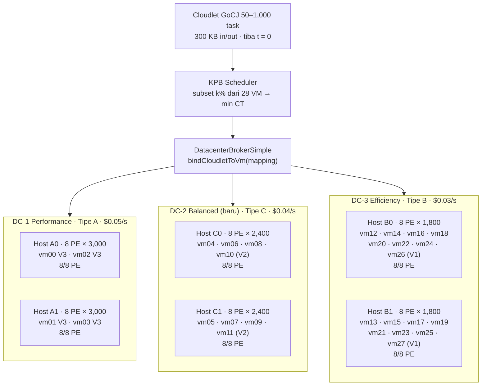

### 14.3 Tabel Penempatan VM per Host

| DC | Host | Tipe host | VM yang ditempatkan | Jumlah VM | PE terpakai | MIPS VM / MIPS host | RAM VM / RAM host | BW VM / BW host |
|:---:|:---:|:---:|:---|:---:|:---:|:---:|:---:|:---:|
| DC-1 Performance | A0 | A | vm00 V3, vm02 V3 | 2 | 8 / 8 | 20,000 / 24,000 | 16 / 32 GB | 2,000 / 10,000 Mbps |
| DC-1 Performance | A1 | A | vm01 V3, vm03 V3 | 2 | 8 / 8 | 20,000 / 24,000 | 16 / 32 GB | 2,000 / 10,000 Mbps |
| DC-2 Balanced | C0 | C | vm04, vm06, vm08, vm10 (V2) | 4 | 8 / 8 | 12,000 / 19,200 | 16 / 32 GB | 4,000 / 8,000 Mbps |
| DC-2 Balanced | C1 | C | vm05, vm07, vm09, vm11 (V2) | 4 | 8 / 8 | 12,000 / 19,200 | 16 / 32 GB | 4,000 / 8,000 Mbps |
| DC-3 Efficiency | B0 | B | vm12, vm14, vm16, vm18, vm20, vm22, vm24, vm26 (V1) | 8 | 8 / 8 | 8,000 / 14,400 | 16 / 32 GB | 4,000 / 5,000 Mbps |
| DC-3 Efficiency | B1 | B | vm13, vm15, vm17, vm19, vm21, vm23, vm25, vm27 (V1) | 8 | 8 / 8 | 8,000 / 14,400 | 16 / 32 GB | 4,000 / 5,000 Mbps |
| **Total** | **6** | — | — | **28** | **48 / 48** | **80,000 / 115,200** | **96 / 192 GB** | — |

### 14.4 Pembagian per Datacenter

| Datacenter | Host | VM | Jumlah VM | PE VM / PE host | MIPS VM / MIPS host | Porsi kapasitas VM |
|:---|:---|:---|:---:|:---:|:---:|:---:|
| DC-1 Performance | A0, A1 | V3 Large: vm00–vm03 | 4 | 16 / 16 (100%) | 40,000 / 48,000 | 50% |
| DC-2 Balanced | C0, C1 | V2 Medium: vm04–vm11 | 8 | 16 / 16 (100%) | 24,000 / 38,400 | 30% |
| DC-3 Efficiency | B0, B1 | V1 Small: vm12–vm27 | 16 | 16 / 16 (100%) | 16,000 / 28,800 | 20% |
| **Total** | **6 host** | **V3 × 4, V2 × 8, V1 × 16** | **28** | **48 / 48** | **80,000 / 115,200** | **100%** |

Setiap datacenter berisi tepat satu kelas VM. VM ditempatkan berurutan dari yang terbesar (V3, lalu V2, lalu V1), dan datacenter diisi berurutan (DC-1, lalu DC-2, lalu DC-3). Keempat V3 menghabiskan 16 PE DC-1, sehingga V2 tidak lagi muat di DC-1 dan pindah ke DC-2. Kedelapan V2 lalu menghabiskan 16 PE DC-2, sehingga semua V1 berakhir di DC-3. Jumlah VM per host jadi berbeda (2, 4, dan 8), tetapi PE setiap host terpakai penuh.

### 14.5 Hasil Simulasi GoCJ (CloudSim)

Grid GoCJ 50–1,000 task × k = 20/50/100% (33 run) dijalankan dengan topologi baru. Rasio makespan CloudSim/analitik 1.005–1.016. Perbandingan dengan desain awal (`results/sessions/cloudsim_gocj_20261009_225810/`) pada tiga skenario S1–S3:

| Task | k | Makespan awal (s) | Makespan baru (s) | Δ | Energi awal (kWh) | Energi baru (kWh) | Δ | Biaya awal (USD) | Biaya baru (USD) | Δ | VM terpakai |
|---:|:---:|---:|---:|:---:|---:|---:|:---:|---:|---:|:---:|:---:|
| 100 | 20% | 367.80 | 322.46 | −12.3% | 0.0875 | 0.0760 | −13.2% | 506.77 | 507.53 | +0.1% | 4 → 6 |
| 100 | 50% | 273.35 | 246.97 | −9.6% | 0.0681 | 0.0614 | −9.9% | 393.43 | 406.88 | +3.4% | 10 → 14 |
| 100 | 100% | 233.08 | **222.83** | −4.4% | 0.0599 | **0.0566** | −5.6% | 345.11 | 374.69 | +8.6% | 20 → 28 |
| 500 | 20% | 1,655.38 | 1,436.82 | −13.2% | 0.3976 | 0.3429 | −13.7% | 2,051.87 | 1,993.35 | −2.9% | 4 → 6 |
| 500 | 50% | 1,146.19 | 1,007.58 | −12.1% | 0.2930 | 0.2600 | −11.3% | 1,440.84 | 1,421.03 | −1.4% | 10 → 14 |
| 500 | 100% | 933.07 | **860.69** | −7.8% | 0.2497 | **0.2308** | −7.6% | 1,185.10 | 1,225.17 | +3.4% | 20 → 28 |
| 1,000 | 20% | 3,331.27 | 2,909.32 | −12.7% | 0.7990 | 0.6927 | −13.3% | 4,062.94 | 3,956.68 | −2.6% | 4 → 6 |
| 1,000 | 50% | 2,313.56 | 2,033.71 | −12.1% | 0.5900 | 0.5233 | −11.3% | 2,841.69 | 2,789.20 | −1.8% | 10 → 14 |
| 1,000 | 100% | 1,880.16 | **1,706.07** | −9.3% | 0.5020 | **0.4582** | −8.7% | 2,321.60 | 2,352.35 | +1.3% | 20 → 28 |

Tabel lengkap 8 metrik untuk 50–1,000 task ada di [`docs/figures/topologi_3dc/gocj_tables.md`](docs/figures/topologi_3dc/gocj_tables.md).

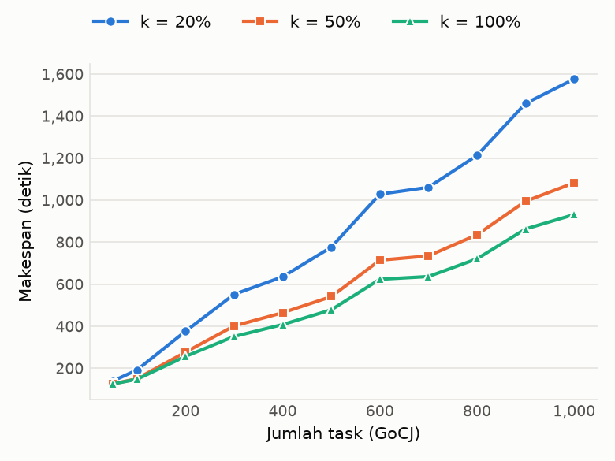

*Makespan topologi baru terhadap jumlah task GoCJ. Urutan k sama dengan desain awal: k = 100% selalu terendah.*

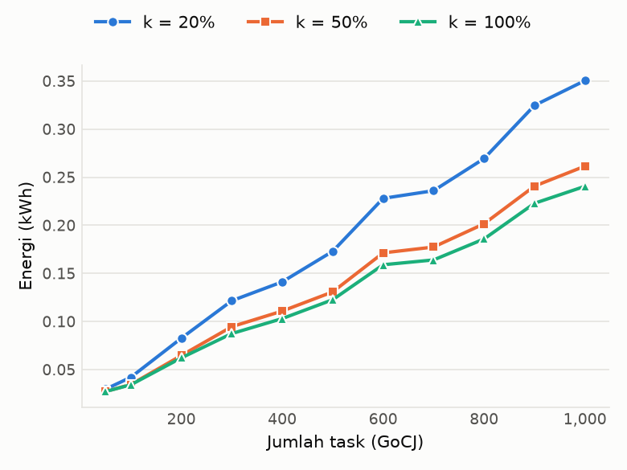

*Energi total 6 host selama makespan (kWh) pada topologi baru.*

### 14.6 Analisis

- **Makespan turun di semua skenario.** Rata-rata penurunan pada 11 ukuran task: 12.1% (k = 20%), 10.5% (k = 50%), dan 7.3% (k = 100%). Penyebabnya kapasitas subset kandidat KPB naik: k = 20% kini memuat 4 V3 + 2 V2 (46,000 MIPS, sebelumnya 40,000), k = 50% memuat 14 VM (66,000 MIPS, sebelumnya 58,000), dan k = 100% memuat 28 VM (80,000 MIPS, sebelumnya 72,000). Sesuai rumus bagian 6.6 (makespan ≈ Σ L / kapasitas subset), batas teorinya −13.0%, −12.1%, dan −10.0%. Pada 500–1,000 task hasilnya mendekati batas itu. Pada task sedikit, penurunannya lebih kecil karena makespan dibatasi task terbesar yang tetap harus dikerjakan satu V3.
- **Energi turun di semua skenario**, rata-rata 12.9% (k = 20%), 10.2% (k = 50%), dan 7.4% (k = 100%), dengan rentang 2.7–13.7%. Ada dua penyebab: makespan lebih pendek, dan total daya idle 6 host turun dari 741 W ke 714 W. Satu host Tipe A (175 W) dan satu host Tipe B (72 W) diganti dua host Tipe C (110 W).
- **Biaya bergantung pada k dan jumlah task.** Ke-28 VM ditagih selama seluruh simulasi, termasuk VM yang idle (`setVmDestructionDelay` di `SimulationSetup`), jadi 8 VM tambahan menambah biaya RAM, BW, dan pemrosesan. Pada k = 20% dan 50% mulai 400 task, tambahan itu tertutup oleh makespan yang lebih pendek, sehingga biaya turun 0.1–2.9%. Pada task sedikit, dan pada k = 100% di semua ukuran, penurunan makespan tidak cukup menutupinya, sehingga biaya naik (k = 100%: +1.2% di 800 task s.d. +12.8% di 50 task).
- **Kesimpulan KPB tidak berubah.** Pada heterogenitas konsisten, k = 100% (setara MCT) tetap memberi makespan dan energi terendah. Kandidat yang lebih banyak berarti kapasitas yang dipakai lebih besar.

### 14.7 Cara Mengulang

```bash
mvn -q clean compile
mvn -q exec:java -Dlog=error            # cek blok "=== Infrastruktur CloudSim ===": 3 datacenter, 6 host, 28 VM

SESSION=results/sessions/cloudsim_gocj_3dc_<timestamp> SOURCE=gocj bash scripts/run_grid_cloudsim.sh
python3 scripts/plot_grid.py gocj=results/sessions/cloudsim_gocj_3dc_<timestamp> --out docs/figures/topologi_3dc
```

### 14.8 Yang Belum Disesuaikan

- **Real-world (bagian 7)** masih memakai 20 container dan 2 datacenter. `kpb_realworld.py` akan berhenti dengan `[ERROR] Kapasitas VM di mapping beda dengan VMS runner ini` sampai `docker-compose.yml`, `kpb_realworld.py`, dan `analyze_grid.py` disesuaikan dengan langkah bagian 9.7. Total kuota CPU topologi baru 80,000 / 10,000 = 8.0 CPU.
- **Grid Synthetic 1,000–10,000 task (bagian 6.3)** belum dijalankan ulang dengan topologi baru.
- **Bagian 3, 6, dan 7** masih berisi angka desain awal.

---

<p align="center">
  <b>Kelompok 5 Strategi Optimasi Komputasi Awan (SOKA)</b><br>
  Departemen Teknologi Informasi, Institut Teknologi Sepuluh Nopember (ITS)<br>
  Surabaya, Indonesia 2026
</p>
